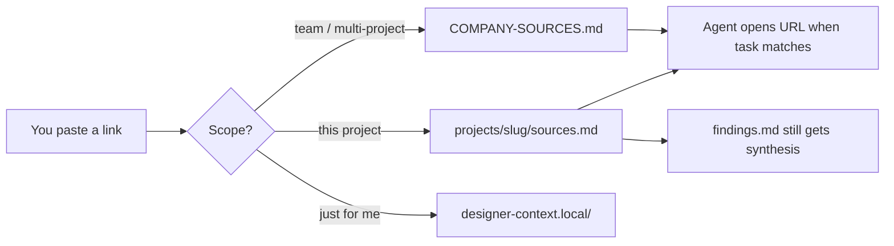

# Company sources — how link indexes work

Living URLs (strategy Docs, articles, Confluence, FigJam, competitor pages)
do **not** get pasted as full bodies into this repo. They live in **link
catalogs**. Agents read the right catalog, then open only the rows that
match the task (IDE browser when signed in).

| Scope | File | Who sees it |
|-------|------|-------------|
| **Global / team** | `context/org-pack.local/COMPANY-SOURCES.md` (your real content) or `context/org-pack/COMPANY-SOURCES.md` (public example) | Everyone who clones (example) / your team only (local) |
| **Per project** | [`projects/<slug>/sources.md`](../../projects/_template/sources.md) | Team (committed with the project) |
| **Per you** | `designer-context.local/` | Your machine only (gitignored) |

This doc covers **all three** scopes. Deep dive on private/profile:
[`designer-context-local.md`](designer-context-local.md).
Agent protocol for the folder:
[`harness/designer-onboarding/references/designer-context-local.md`](../../harness/designer-onboarding/references/designer-context-local.md).

---

## Quick reference

| What | Path |
|------|------|
| Global link catalog (resolved) | `COMPANY-SOURCES.md` — see `harness/ORCHESTRATOR.md` §0a for local-vs-example resolution |
| Project link catalog (template) | `projects/_template/sources.md` |
| Example (referrals) | `projects/invite-friends/sources.md` |
| **Private / profile links** | `designer-context.local/**/sources.md` — [`designer-context-local.md`](designer-context-local.md) |
| Standing business facts | `COMPANY-BUSINESS.md` (resolved) |
| Project folder schema | `projects/README.md` |
| Wired into kickoff | `harness/skills/design-kickoff/SKILL.md` Step 1 |
| Wired into research | `harness/skills/research-agent/SKILL.md` + `references/agents.md` |
| Wired into UX critiques (when priority fit matters) | `harness/skills/ux-pattern/SKILL.md` |
| Orchestrator state rules | `harness/ORCHESTRATOR.md` §5 |

---

## Mental model

| Layer | Where | What |
|-------|--------|------|
| **Map (global)** | `COMPANY-SOURCES.md` (resolved) | Team-wide links + when to open |
| **Map (project)** | `projects/<slug>/sources.md` | Articles/comps/Docs for that task |
| **Facts** | `COMPANY-BUSINESS.md`, voice, archetypes, patterns (resolved) | Distilled knowledge in git |
| **Synthesis** | `projects/<slug>/findings.md` | What skills concluded from those links |
| **Living content** | The URLs themselves | Canonical; ACL-gated; open when needed |

Never dump full Doc/article bodies into markdown.

---

## Per project — `sources.md`

Every new project folder (from `projects/_template/`) includes
`sources.md`. It is mandatory like `brief.md` / `findings.md`.

### What belongs there

- Articles, competitor pages, Docs, decks, FigJam/Miro you care about
  **for this project**
- Durable URLs a skill cites that you want to find again on resume

### What does not

- Primary Figma / Jira / Confluence for the brief → `brief.md` **Sources:**
- Team-wide strategy / company Docs → `COMPANY-SOURCES.md`
- Personal-only reading → `designer-context.local/`
- Long write-ups → `findings.md` (cite the `sources.md` row)

### How to add (you or the agent)

1. Open `projects/<slug>/sources.md` (create from template if a legacy
   folder is missing it).
2. Append a row:

   | Title | Kind | Why it matters | Link | Indexed |
   |-------|------|----------------|------|---------|
   | Real title | Article | One line for agents | full URL | YYYY-MM-DD |

3. If a skill also synthesises the link, append that analysis to
   `findings.md` as usual — **both** places, not either/or.

**Standing agent rule:** when you paste a URL while working a known
`projects/<slug>/`, append a `sources.md` row in the same turn (ask once
if global vs project vs personal is unclear).

---

## Per you — private / profile (`designer-context.local/`)

**Gitignored.** Only your clone. Full how-to:
[`designer-context-local.md`](designer-context-local.md).

### What belongs there

- Private reading lists, DM-only links, "not ready for the team" bookmarks
- Topic folders (`referrals/`, `1on1s/`) with their own `sources.md`
- Optional `projects/<slug>/` under local context for private notes about a
  **shared** project (committed links still live in `projects/<slug>/sources.md`)

### How to add

1. Ensure `designer-context.local/README.md` exists (index).
2. Append a row to `designer-context.local/sources.md` or
   `designer-context.local/<topic>/sources.md`.
3. Say *"save this privately / to my local context"* so the agent does not
   write into the committed project catalog.

**Standing agent rule:** private / for me / local only →
`designer-context.local/` only; never promote into `projects/` or
`context/` without an explicit ask.

### Promote later

*"Move this into the referral project sources"* → copy row to
`projects/<slug>/sources.md` (and optionally remove from local).

---

## Global — `COMPANY-SOURCES.md` (resolved)

The "global sources" file resolves to `context/org-pack.local/COMPANY-SOURCES.md`
if that folder exists on this machine, else `context/org-pack/COMPANY-SOURCES.md`
(the public example). See `harness/ORCHESTRATOR.md` §0a.

### What belongs in the index

Add a row when **all** of these are true:

- Cross-squad / company / multi-initiative (not one ticket's PRD)
- Agents should find it again without you pasting the URL every time
- Stable URL (Docs, Sheets, Slides, Confluence, FigJam/Figma, Miro, Drive)

**Do not** put here:

- Project-specific articles → `projects/<slug>/sources.md`
- Personal notes → `designer-context.local/`
- Secrets / private 1:1 material
- Evergreen *facts* — keep those in `COMPANY-BUSINESS.md` (etc.); you may
  still list the upstream Doc in Sources as the link

### How to add a global link

1. Open the resolved `COMPANY-SOURCES.md` (your `org-pack.local` copy if
   you have one, else `context/org-pack/COMPANY-SOURCES.md`).
2. Pick a section: **Strategy / planning**, **Content**, **Research**,
   **Design system**, or **Other**.
3. Add a table row:

   | Title | Kind | When to open | Link | Indexed |
   |-------|------|--------------|------|---------|
   | Real Doc title | Strategy | e.g. kickoff / OKR / quarter fit | full URL | today's date |

4. Commit with the rest of your harness change (public example pack), or
   just save it (real company pack is gitignored, nothing to commit
   upstream).

**Standing agent rule:** when you paste a new *global* resource in chat,
the agent should append a row in the same turn (or ask which section if
unclear).

### When agents open global links

| Skill | Behaviour |
|-------|-----------|
| **design-kickoff** | Reads the index at Step 1; opens rows whose topic / "When to open" matches the project |
| **research-agent** | Treats matching rows as seed URLs (same Google Docs open path as links found in Confluence/Jira) |
| **ux-pattern** | Opens matching rows only when quarter priority / initiative fit is in scope |
| **ui-agent** | Does **not** open every source on micro-edits — pillars stay on `COMPANY-BUSINESS.md` |

If the Doc needs Google login and the browser can't see it, the agent lists
the URL and says so — it must not invent strategy claims from titles alone.

---

## Strategy Docs vs evergreen facts

- **Strategic pillars / north star** live in `COMPANY-BUSINESS.md` — evergreen product framing.
- **Next-quarter / planning Docs** live as rows under Strategy in
  `COMPANY-SOURCES.md` — rotate or retire when the quarter rolls; do not
  rewrite BUSINESS for that.

---

## Related

- Private / profile link catalogs:
  [`designer-context-local.md`](designer-context-local.md)
- Opening Google Docs in chat: [`documentation/setup/mcps/optional.md`](../setup/mcps/optional.md#browser)
- Source-link formatting in agent output: `harness/references/source-links.md`
