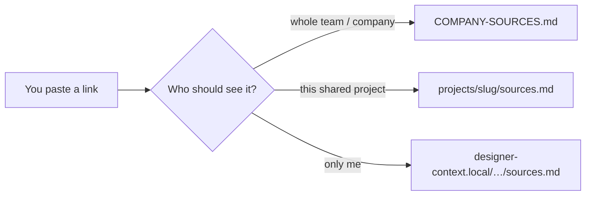

# Personal & private links — `designer-context.local/`

How to keep **link catalogs and notes that must not leave your machine** —
same privacy model as `designer-profile.local.md` (gitignored, never
pushed).

Team-shared links use other catalogs:

| Scope | Where | Guide |
|-------|--------|------|
| Global / team | `COMPANY-SOURCES.md` | [`company-sources.md`](company-sources.md) |
| Shared project | `projects/<slug>/sources.md` | same HOWTO § Per project |
| **Private / profile** | `designer-context.local/` | **this doc** |

Protocol agents follow for the folder:
[`harness/designer-onboarding/references/designer-context-local.md`](../../harness/designer-onboarding/references/designer-context-local.md).

---

## Quick reference

| What | Path |
|------|------|
| Profile (role, prefs, active work) | `designer-profile.local.md` |
| Personal context tree (gitignored) | `designer-context.local/` |
| Index agents read first | `designer-context.local/README.md` |
| Private link tables (recommended) | `designer-context.local/**/sources.md` |
| Private notes for a topic/project | `designer-context.local/<topic>/` or `…/projects/<slug>/` |
| Onboarding mention | `documentation/guides/onboarding.md` |

---

## Mental model



**Profile** (`designer-profile.local.md`) = who you are for the harness
(role, interaction style, optional squad).  
**Personal context** (`designer-context.local/`) = standing notes and
**private link catalogs** agents should load when relevant.

Never ask the agent to copy private material into `projects/`, `context/`,
or harness docs unless you explicitly want it committed.

---

## Setup (once per clone)

1. Create `designer-context.local/` at the repo root (next to
   `designer-profile.local.md`).
2. Add a root `README.md` (index — see § Starter layout).
3. Optionally add topic folders and `sources.md` files (below).
4. Confirm with `git status` — the folder must **not** show as untracked
   (`.gitignore` already covers it).

Say in chat: *“set up my local context”* or *“check my local context”*
if you want the agent to create/read this tree.

---

## Private link catalogs (`sources.md`)

Use the **same row shape** as project/global sources, under your local
tree:

| Title | Kind | Why it matters | Link | Indexed |
|-------|------|----------------|------|---------|
| Cool article | Article | Idea for later / not ready to share | https://… | YYYY-MM-DD |

### Recommended layout

```text
designer-context.local/
  README.md                 # map: when to read what
  preferences.md            # taste log — rules you saved, by work type
  sources.md                # optional — cross-cutting private links
  referrals/                # topic folder (example)
    README.md
    sources.md              # private articles for referrals work
    notes.md
  projects/                 # optional — private notes per shared slug
    invite-friends/
      sources.md            # links you refuse to commit yet
      notes.md
```

**`designer-context.local/projects/<slug>/`** is for *private* material
about a *shared* project. The team still uses
`projects/<slug>/sources.md` for committed links. Same slug name keeps
agents oriented; different root keeps privacy.

---

## What belongs in private sources

- Reading list you are not ready to put on the team project
- Draft URLs, half-baked comps, personal bookmarks
- Links from DMs / 1:1s you do not want in a pushed `findings.md`
- “Always consider this for me” links that are not company strategy

## What does not

- Anything the **team** should reopen on resume →
  `projects/<slug>/sources.md`
- Company / multi-initiative Docs → `COMPANY-SOURCES.md`
- Secrets (passwords, tokens) — never put those in markdown, local or not
- Synthesis the team needs → still use committed `findings.md` (paraphrase;
  omit private URLs or ask before promoting)

---

## How to add a private link

1. Decide: private forever vs promote to project later.
2. Append a row to the right local `sources.md` (create the file if needed).
3. Tell the agent explicitly when needed:
   - *“save this to my local context / private sources”*
   - *“don’t put this in the project sources yet”*
4. To **promote** later: ask *“move this link into the referral project
   sources”* — agent copies the row into `projects/<slug>/sources.md`
   and leaves or removes the local row per your instruction.

**Standing agent rule:** if you say the link is private / for me / local
only, append under `designer-context.local/` and **do not** write it into
committed `projects/` or `context/` without confirmation.

---

## When agents read private context

| Trigger | Behaviour |
|---------|-----------|
| Task matches a nested folder listed in local `README.md` | Read that folder’s `README` + `sources.md` / notes |
| You say “check my local context” / name a path | Open those files |
| Kickoff / research / critique on a topic you track locally | Prefer local map, then open matching private links |
| Trivial one-liner | Do **not** dump the whole local tree |

Agents **never** push or force-add `designer-context.local/`.

---

## Starter layout (copy-paste)

### `designer-context.local/README.md`

```markdown
# Personal context (local only)

Gitignored. Agents read this index first, then matching paths.

| Path | When to read |
|------|----------------|
| preferences.md | Only the matching work-type section, by its reader skill |
| sources.md | Cross-cutting private bookmarks |
| referrals/ | Referral / growth topics |
| projects/invite-friends/ | Private notes for that shared project |
```

### `designer-context.local/sources.md` (optional root table)

```markdown
# Private sources (local only)

| Title | Kind | Why it matters | Link | Indexed |
|-------|------|----------------|------|---------|
```

### `designer-context.local/referrals/sources.md` (topic example)

```markdown
# Private sources — referrals

| Title | Kind | Why it matters | Link | Indexed |
|-------|------|----------------|------|---------|
```

---

## Profile vs local context

| File | Stores | Example |
|------|--------|---------|
| `designer-profile.local.md` | Role, interaction style, squad, standing prefs | “always run harness for critiques” |
| `designer-context.local/**` | Freeform notes + **private link tables** | article backlog, 1:1 scratch, topic folders |

Your profile may *point* at the local folder (e.g. “Extra local context:
`designer-context.local/`”) — that does not commit the folder contents.

---

## Related

- Three-scope link map: [`company-sources.md`](company-sources.md)
- Onboarding / profile gate: [`onboarding.md`](onboarding.md)
- Agent protocol: [`harness/designer-onboarding/references/designer-context-local.md`](../../harness/designer-onboarding/references/designer-context-local.md)
