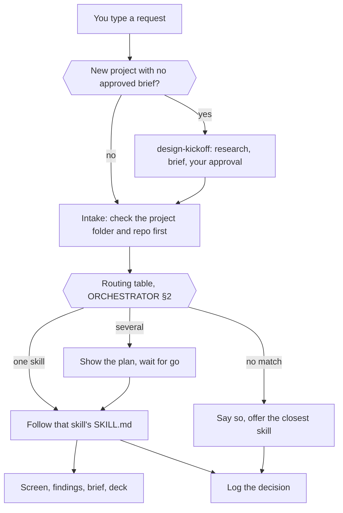

# How the harness works

You type a plain request. The AI in your chat reads one file,
`harness/ORCHESTRATOR.md`, which decides which skill playbooks to run, what
to ask first, and when to stop for your approval. This guide shows what
happens between your sentence and the result.

---

## At a glance

Every decision, matched or not, leaves a record.

---

## The pieces

| Piece | Where | What it does |
|---|---|---|
| **Orchestrator** | `harness/ORCHESTRATOR.md` | Onboarding check, company-pack resolution, intake, the routing table, the plan gate, the fallback, logging rules, design-system guardrails |
| **Skills** | `harness/skills/<name>/SKILL.md` | One playbook per kind of work. Each has a `GUIDE.md` for people next to it |
| **Shared references** | `harness/references/` | Rules several skills share: writing checks, question UI, artifact types |
| **Harness upkeep** | `harness/harness-audit/`, `harness/task-intake/`, `harness/logs/` | Self-audit, routing evals, routing standards and logs |
| **Company pack** | `context/org-pack.local/` or `context/org-pack/` | Your business, voice, personas, patterns, squads, sources. Local first, the Northline example otherwise |
| **Design system** | `context/design-system/` | `tokens.css` and the `ds/` primitives every screen is built from |
| **Project memory** | `projects/<slug>/` | `brief.md`, `findings.md`, `decisions.md`, `log.md`, `screens/`, `docs/` |
| **Your profile** | `designer-profile.local.md` | Role, tools, squad. Gitignored |

Everything except the `.local` files is ordinary, committed files. Anyone
who clones the repo gets the same orchestrator and skills with no extra
install step.

`CLAUDE.md` and `AGENTS.md` at the repo root are only pointers to the
orchestrator, so Claude Code, Cursor, and Codex all start from the same
place. Cursor also loads always-on rules from `.cursor/rules/` that enforce
the same gates.

---

## A request, end to end

Say you type: **"build me a calendar screen."**

1. **Profile gate.** The AI checks for `designer-profile.local.md`. If it's
   missing, onboarding runs once. If it exists, nothing is asked.
2. **Intake** (§1). Before asking anything, it checks `projects/` for a
   matching folder, whether the screen already exists, and what your
   message and profile already say. It asks at most three questions, in one
   batch, with clickable options.
3. **Routing** (§2). "Build a screen" matches the `ui-agent` row. A screen
   implies tokens (`design-system`) and icons (`icon-usage`), and a full
   build closes with `audit`.
4. **Plan gate** (§3). That's more than one skill, so you see the plan and
   say go.
5. **Build.** `ui-agent` reads the guardrails, your company business and
   archetypes, the `ds/` primitives, and `tokens.css`. Before any CSS value
   is written, `design-system` checks the token exists: use it, use the
   nearest one, or stop and ask you about a real gap. Icons come from the
   `Icon` primitive, never hand-drawn SVG.
6. **Where it lands.** The screen goes in
   `projects/<slug>/screens/<Name>Page.tsx`. The app discovers it, so no
   route is registered by hand.
7. **Audit.** `audit` checks design system, accessibility, and copy. Copy
   issues hand off to `content`. You can set `audit` to run only when you
   share (`harness.config.local.json`).
8. **Logging.** One line in the project's `log.md`. Skill use is recorded
   automatically; `harness/logs/routing-log.md` gets a line only for a
   fallback, a wrong match, or an approved plan.

You typed one sentence and approved one plan. Steps 1 to 8 happen without
you choosing skills.

---

## New projects start with research

When there's no approved brief for the thing you're asking about,
`design-kickoff` runs first:

1. Three short questions (name, what you already have, who the PM is).
2. `workload-agent`: is someone already on this?
3. `research-agent`: what exists in your docs, tracker, chat, Figma, and
   Miro.
4. `assumption-mapper`: what's known vs only believed.
5. A brief with job stories in `projects/<slug>/brief.md`.
6. **The gate.** Nothing is built until you approve the brief.

Connected tools make step 3 richer. Without them, research uses what you
paste and the web.

---

## When nothing matches

The AI says so in its first sentence, names the closest skill, and asks:
run that, or answer freely without harness context. It never gives a
normal answer as if a skill had run. The miss is logged, and
`harness-audit` uses those misses to propose new routing rows.

---

## Why a routing file instead of one dispatcher skill

An earlier version used a single auto-discovered dispatcher skill. A plain
file read at the start of every chat adds three things it couldn't do:

1. **State across sessions.** Project folders let any chat pick up where
   the last one stopped.
2. **A plan gate.** Multi-skill work is shown before it runs.
3. **A record of misses.** Fallbacks and misroutes are logged, so the
   routing table improves from real use.

The trade-off is that the agent reads the orchestrator directly instead of
relying on the tool's own skill scanner.

---

## Adding a skill

See [Build a skill](../maintainers/build-a-skill.md). In short: write
`harness/skills/<name>/SKILL.md` and a `GUIDE.md`, add a row to §2 with real
trigger phrases, add a page in `documentation/skills/`, then run the
routing evals in `harness-audit`.

---

## Related

| File | What it covers |
|------|------|
| [Agents vs skills](agents-vs-skills.md) | Agent roles are an org chart, not separate AIs |
| [Confidence and autonomy](confidence-autonomy.md) | Medium-confidence routing lines and the per-task autonomy dial |
| [Spec vs runtime](spec-vs-runtime.md) | What is enforced by code vs only written as rules |
| [Company context](company-context.md) | Setting up your company pack |
| [Evals](../maintainers/evals.md) | How routing changes are tested |
| [All skills](../skills/) | One page per skill |
