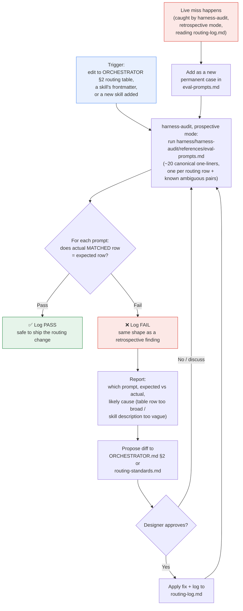

# Evals — what they are, why this harness needs them, how they work

**Status: built.** No new skill was created — this is a second mode
**inside the existing `harness-audit` skill**, not a standalone router or
skill. See `harness/logs/routing-log.md` 2026-08-04 for the conversation
that produced it, and the decision to fold it in rather than stand up a
separate skill.

---

## What is an eval, in one sentence

**An eval is a fixed test question with a written-down correct answer,
that you re-run every time you change the thing being tested — so you find
out you broke something *before* a person does, instead of after.**

That's it. Everything below is detail on top of that one idea: what kinds
of "correct answer" exist, why this specific repo needs it, and how the
one built here actually runs.

### A concrete example, from this repo

`harness/harness-audit/references/eval-prompts.md` has rows like this one:

| # | Prompt | Expected match |
|---|--------|-----------------|
| 1 | "Let's start working on a referral leaderboard, city by city." | `design-kickoff` |

Read literally, that row says: *if someone types that sentence, the
routing table in `harness/ORCHESTRATOR.md` §2 should send it to
`design-kickoff` — not `ui-agent`, not a fallback, not anything else.*

Running the eval means: take that exact prompt, reason it through the
**current** §2 table (or actually run it in a fresh chat), and check —
does it still land on `design-kickoff`? If yes, that row **passes**. If a
recent edit to §2 quietly changed the front-door wording enough that this
phrase no longer matches anything, that row **fails** — and you just
found a real regression before a designer hit it live.

Multiply that by the ~75 rows in the real file (one per routing row, plus
a table of pairs that are easy to confuse with each other) and that's the
whole prospective eval suite: a checklist of "this exact input should
still produce this exact routing decision," re-run after any change to
the thing that decides routing.

---

## Quick reference

| What | Where |
|------|-------|
| Existing retrospective check | `harness/harness-audit/SKILL.md` § What to read (retrospective) — reads real logged misroutes after the fact |
| **New prospective check** | `harness/harness-audit/SKILL.md` § Prospective routing check (evals) — runs the canonical prompt set *before* a routing/skill change ships |
| Seed prompt set | `harness/harness-audit/references/eval-prompts.md` — one case per §2 routing row + known ambiguous pairs |
| Existing narrow-scope prospective test (unrelated, unchanged) | `tests/project-briefing-prompts.md` — scripted prompts, but only for the project-briefing agent |
| Routing entries | `harness/logs/routing-log.md` 2026-08-04 |

---

## What "evals" means, in general

An **eval** (evaluation) is a repeatable test that scores how an AI
system behaves against a defined expectation — the AI-world equivalent
of unit/integration tests, but for outputs that are often not exact
strings. Three common shapes:

1. **Golden/reference evals** — fixed input → expected output (or
   expected *class* of output), scored by exact match or simple rule.
   Best for narrow, deterministic-ish tasks: routing, classification,
   extraction.
2. **Rubric / LLM-as-judge evals** — a grader (human or model) scores
   free-form output against written criteria — tone, completeness,
   policy compliance. Needed when there's no single "right" string:
   writing quality, critique depth, etc.
3. **Trace / behavioral evals** — not just the final answer, but *did
   the process follow the required steps* (right tool called, asked
   before acting, logged correctly). This is the one that matters most
   for a rules-and-routing system like this repo — most of the hard
   rules here are about *sequencing*, not prose quality.

### Best practices

- **Small and specific beats large and vague.** A short suite mapped
  1:1 to real routing rows catches more real regressions than a big
  generic benchmark.
- **Evals should mirror real failures, not hypothetical ones.** The
  highest-signal cases come from actual misroutes/fallbacks already
  logged — turn each real miss into a permanent regression case.
- **Version them with the thing they test.** A suite that isn't
  updated when a skill is added (this repo adds skills almost every
  session — `ticket-create`, `deck-builder` both landed today) rots
  fast and gives false confidence.
- **Separate "right skill matched" from "output was good."** Routing
  correctness is cheap to check (row match); output quality needs a
  rubric or human spot-check. Don't conflate the two in one score.
- **Run at the right trigger points**, not on a fixed calendar
  disconnected from actual changes.
- **Make failures actionable** — point at which rule/row to fix, not
  just "case 7 failed."

---

## Why this repo specifically would benefit

This harness has no dispatcher server — `harness/ORCHESTRATOR.md` §2's
routing table, read fresh each turn, *is* the routing logic. That table
changes constantly (new skills, tightened scope boundaries, new
fallback rows) and the only feedback loop today is:

- **Retrospective:** `harness-audit` notices a pattern in
  `harness/logs/routing-log.md` after several live misses.
- **Live:** the designer notices a bad match in the moment and
  redirects.

Both catch problems *after* they've already happened at least once.
Nothing today answers "if I edit this routing row, did I just break a
different, previously-working trigger phrase?" before shipping the
edit — which is exactly the failure class the
`ReferralWalletPrototypePage.tsx` icon drift and the "ticket-create
freestyle" miss (`KNOWN-ISSUES.md`, `harness/skills/ticket-create/GUIDE.md`)
both belong to: a working thing quietly regresses and gets
re-discovered as new.

---

## The flow (as built)

**Key relationships:**

- **Retrospective mode** (`harness-audit`, unchanged) mines real logged
  misroutes and feeds them *into* the seed set as new permanent cases
  (bottom loop).
- **Prospective mode** (new, same skill) runs *before* a routing/skill
  description change ships, using real-miss-derived cases plus one
  canonical case per skill row.
- **Nothing auto-applies** — same posture `harness-audit` already had:
  report → designer approves → apply → re-run to confirm the fix
  actually closed the gap. No new "auto-fix" behavior was introduced.
- **The check itself is not optional, even though the check is
  manually-run.** "Manually-run" describes the mechanism (CI doesn't run
  evals — someone/something has to invoke them), not the trust level. Whenever a
  harness routing/logic mistake gets identified and fixed in a
  conversation — a live MISROUTE, a wrong §2 row, a skill bug — running
  prospective mode (seed the case, verify the fix) is a **mandatory step
  of finishing that fix**, same turn, same as showing the §3 plan before
  a multi-skill chain executes. It should never require the designer to
  separately ask "now run the evals."
- **This is not a new router or a new skill** — it's a second mode
  inside the one existing self-audit skill. See the chat that produced
  this doc for why that shape was chosen over a standalone skill.

---

## What it does NOT do

- **Not a replacement for retrospective log mining** — that stays exactly
  as it was.
- **Not a rubric/quality grader for *design output*** (critique depth,
  copy quality) — that's a different, harder problem and out of scope
  for this pass. This is routing-correctness only.
- **Not a CI job / automated gate** — CI runs lint and the build only, and
  every designer runs their own clone (`INSTALL.md` § Use it with a team), so
  this is a **manually-run check**, same trust model `harness-audit`
  already had.
- **Not something that edits `ORCHESTRATOR.md` unilaterally** —
  proposals only, per this repo's standing rule for harness self-edits.
- **Not a new skill or a new router** — see the note under the diagram
  above.

---

## How it was decided

Three shapes were on the table: a standalone skill, a new mode inside
`harness-audit`, or holding off entirely on a seed list first. **Folded
into `harness-audit`** was chosen because the audience (whoever's
maintaining the harness) and the trust posture (report → approve →
apply) were already identical to the existing skill — a new skill row
for something this narrow would have added table surface without adding
a genuinely new capability.

---

## Related

| Doc | Role |
|-----|------|
| [`harness/harness-audit/SKILL.md`](../../harness/harness-audit/SKILL.md) | Both modes now live here — retrospective (unchanged) + prospective (new) |
| [`harness/harness-audit/references/eval-prompts.md`](../../harness/harness-audit/references/eval-prompts.md) | The actual seed set — one case per §2 row + known ambiguous pairs |
| [`tests/project-briefing-prompts.md`](../../tests/project-briefing-prompts.md) | Existing narrow prospective test, scoped to project-briefing only — unrelated, unchanged |
| [`harness/logs/routing-standards.md`](../../harness/logs/routing-standards.md) | Per-skill trigger-phrase audit — seed source for the eval cases above |
| [`harness/logs/routing-log.md`](../../harness/logs/routing-log.md) | Real routing history — source of real-miss eval cases |
