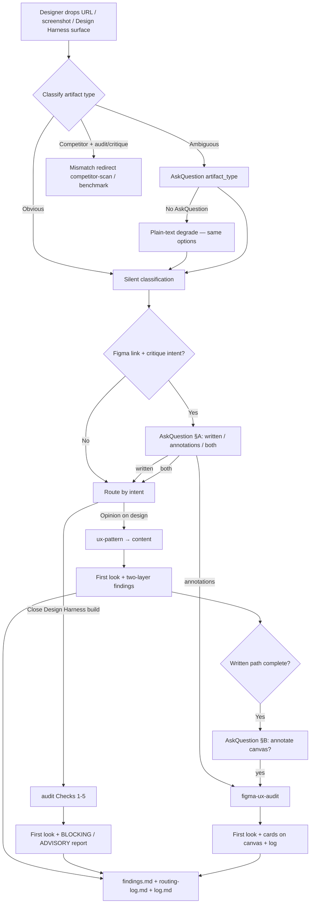

# Critique and audit system — how it works

Reference for the harness routing and skills that turn “audit this / any thoughts?” into structured, logged critique — grounded in general UX craft and house standards — without the designer naming individual skills. Behavior described here matches what is wired on the branch this was developed on (commits through `e8c8583` and related harness edits on that branch). Claims trace to files listed in [Source map](#source-map) at the end.

---

## 1. Overview

The system exists so designers and PMs can drop **Figma boards, Design Harness prototypes, live production screenshots, or competitor references** and get a critique that is **not freestyle chat**.

**Debt scope:** Project-level critique/audit advisories deferred after a pass → **`projects/<slug>/debt.md`** (per-project, committed). Repo / DS / structural debt → **`KNOWN-ISSUES.md`**. Do not conflate the two (`harness/references/project-debt-register.md`). The orchestrator classifies what was dropped, routes to the right skill chain, applies a **two-layer** labeling convention (industry craft vs house rules), optionally places **Figma canvas annotation cards**, and **logs** every match to `harness/logs/routing-log.md` and the active task’s `findings.md` / `log.md`. Entry point: `harness/ORCHESTRATOR.md` §2 (design-critique, `audit`, `figma-ux-audit` rows) and §2d; enforced in Cursor via `.cursor/rules/orchestrator-gate.mdc` and `.cursor/rules/figma-critique-harness.mdc` (instruction-following only — see [Known limitations](#8-known-limitations)).

---

## 2. Front door — artifact-type classification

Canonical rules: [`harness/references/artifact-type-critique.md`](../references/artifact-type-critique.md). Every design-critique, `audit`, and `figma-ux-audit` run is supposed to classify the drop **before** checks run.

| Type | How it is recognized | What changes in the critique |
|---|---|---|
| **Figma board (pre-build)** | `figma.com/design` / FigJam URL, or designer says board/frame | **Exploratory** tone; pattern + content + heuristics. **No** Design Harness `audit` DS/token/code gate (nothing shipped in repo yet). |
| **Built Design Harness prototype** | `#/playground/…`, `src/design-harness/pages/…`, or named lab prototype in `projects/<slug>/` | Full **`audit`** (Checks 1–5) when closing a build; design-critique can run in parallel for structure/copy. Lab / pre-share tone unless they say it mirrors production. |
| **Live production** | Production URL (`yourcompany.com`, store build, “this is live”), or designer says shipped/prod | Same craft/pattern/content judgment as prototypes, but **live-impact framing** (“fix / mitigate now”, not “open GTM questions”). **No** Design Harness DS/`audit` on screenshot alone — no repo files. Written path: design-critique; `audit` only if they also point at lab code. |
| **External / competitor** | Named competitor (e.g. Airbnb), Mobbin, clearly not our own product's UI | **Not** a house critique/`audit`. Route **`competitor-scan`** or **`benchmark`**. Mismatch redirect when they said “audit/critique” on competitor UI. |

**Obvious cases** → classify silently and continue (examples in the reference: Figma link, Design Harness route, `yourcompany.com` in chrome, “audit Airbnb’s …”).

**Ambiguous cases** → one `AskQuestion` with `id: "artifact_type"` and options `figma_prebuild`, `design-harness`, `live_prod`, `external`, `other` (JSON in `artifact-type-critique.md`). Do **not** guess the type.

**Competitor mismatch** (they asked audit/critique but artifact is not our own product's):

1. Say so in the first sentence.
2. Offer `competitor-scan` / `benchmark`, critique **our** equivalent, or Other… (via `AskQuestion` when available).
3. Do not apply our own tokens/`COMPANY-PATTERNS` to their UI as if it were ours.

Verified example: routing log `2026-07-25T19:55` / `19:56` — “audit this Airbnb referral screenshot” → `MATCHED competitor mismatch`, redirect `competitor-scan` / `benchmark`, no house `ux-pattern`/`content` (`harness/logs/routing-log.md`).

**AskQuestion UI:** Drop-time Figma mode (§ A) and ambiguous artifact type use Cursor’s native `AskQuestion` tool when available (`harness/references/ask-question-ui.md`). **Proven in a Composer session** on 2026-07-25 (§A `figma_review_mode=annotations`, §B `post_critique_annotate=yes_annotate`) — see routing log lines `2026-07-25T17:03`–`17:04`. **When `AskQuestion` is absent** (e.g. some Grok sessions): **plain-text degrade** — same options in chat, wait for typed reply; do **not** switch-model block, and do **not** guess (`KNOWN-ISSUES.md`; regression fix 2026-07-27). V5 verification logged `AskQuestion ABSENT` — no guess (`routing-log.md` `2026-07-25T19:55` / `19:56`).

---

## 3. Three routes (not three names for the same thing)

“Design-critique” is an **orchestrator row**, not a separate `SKILL.md`. It chains skills. The other two are standalone skills.

### Design-critique (`ux-pattern` → `content`)

| | |
|---|---|
| **When it fires** | ORCHESTRATOR §2 row: “audit / critique / review / any thoughts / gut check” on work already produced (Figma, screenshots, Design Harness screen, named project surface). §2d hard rule — no ad-hoc critique. |
| **What it checks** | **`ux-pattern`**: archetype, `COMPANY-PATTERNS`, provider vs client model, structure (`harness/skills/ux-pattern/SKILL.md`). **`content`** when copy/CTAs matter (`harness/skills/content/SKILL.md`). Figma sources: fetch via Figma MCP before writing. |
| **Output** | `### First look` paragraph, then itemized `[House: …]` / `[UX Heuristic: …]` findings; append to `projects/<slug>/findings.md`; log routing. |
| **Real example** | Notifications board Figma `3275:6350`: `MATCHED design-critique` → `ux-pattern → content`, findings appended (`routing-log.md` `2026-07-25T13:25`–`13:30`; `findings.md` § `2026-07-25 — ux-pattern (Notifications board Figma 3275:6350)`). |

Does **not** auto-run Design Harness `audit` unless they also want the code sweep on built files (§2d).

### `audit` (Design Harness pre-share gate)

| | |
|---|---|
| **When it fires** | “Run the audit / check before sharing / is this ready” on **built** prototype in repo; or last step of `ui-agent` build chain (ORCHESTRATOR §2 row). Artifact gate: Figma-only / live screenshot / competitor → redirect per `harness/skills/audit/SKILL.md` § Artifact type. |
| **What it checks** | Checks 1–2 **BLOCKING** (DS + a11y markup/POUR). Checks 3–4 **ADVISORY** house (copy, patterns). Check 5 **ADVISORY** craft. Check **5b** **ADVISORY** Nielsen H1–H10 + one-task walkthrough (`audit/references/heuristic-pass.md`). |
| **BLOCKING vs ADVISORY** | House technical/DS/a11y blockers block share; craft and heuristics (Checks 5 / 5b) are never promoted to BLOCKING (`audit/SKILL.md` § Two layers). **BLOCKED** → fix and re-run; no share, no gallery, no push prompt. **PASS** → advisories noted; designer decides; optional debt register + gallery + GitHub sync prompt. |
| **Mandatory close** | Described as “mandatory final gate before sharing” in skill frontmatter; build chains append `audit` after `ui-agent`. |
| **Real example** | Profile banner after post-critique fixes: `MATCHED audit` → PASS 0 blocking, 2 house + 2 craft advisory (`routing-log.md` `2026-07-25T17:25`; `findings.md` § `2026-07-25 — audit (two-layer verify) — Profile banner prototype` and V2 First look block). |

### `figma-ux-audit` (canvas annotations)

| | |
|---|---|
| **When it fires** | Explicit triggers (“annotate this Figma”, “notes on the canvas”) → §2 **`figma-ux-audit`** row directly. Otherwise only after opt-in: drop-time AskQuestion § A (`annotations` / `both`) or post–written-critique § B (`offer-questions.md`). **Never auto-run.** |
| **What it does** | Loads same ground truth as design-critique (`ux-pattern` ± `content`); places colour-coded cards via Figma MCP `use_figma` + `scripts/card-builder.js`; each card labels `[UX Heuristic: …]` or `[House: …]` (`figma-ux-audit/SKILL.md`). **First look** in chat/findings before card list. Figma **pre-build only** — wrong artifact type → redirect. |
| **vs written findings** | Written path = `findings.md` itemized critique. Annotations = visual cards on canvas; can reuse prior `findings.md` as primary source. § A: choose written / annotations / both. § B: after written-only, offer annotate follow-up. |
| **Real example** | Post–Notifications critique: 5 cards on nodes `3275:6360` + `3275:6418` (`routing-log.md` `2026-07-25T16:58`; `findings.md` § `figma-ux-audit (Notifications 3275:6350)`). |

---

## 4. Two-layer standard

Shared convention (same labels everywhere):

| Layer | Label | Role |
|---|---|---|
| Global UX craft | `[UX Heuristic: <name>]` | Nielsen-style heuristics + senior craft judgment (hierarchy, affordance, etc.) — not House-specific. |
| House standards | `[House: <source> — <rule>]` | House ground truth: patterns, archetypes, business, content, tokens. |

**Sources:** `harness/agents/product-designer.md` (§ Two layers), `audit/SKILL.md` § Two layers, `figma-ux-audit/SKILL.md` § Card format.

**Precedence:** If something is both craft-questionable and a company violation, **House stays the harder call**; craft must not soften a company blocker. Prefer **two labelled points** over one blended note (`product-designer.md`; `audit/SKILL.md`: “do not let craft soften a company blocker”; `figma-ux-audit/SKILL.md`: “House violations stay the harder finding when both layers apply”).

**Verification status for precedence:** The branch has **two-layer audits and critiques** where house and craft advisories appear **on the same screen** (profile banner: dual-offer house advisory + hierarchy/consistency craft advisories) with **First look** tying them to one root cause (`findings.md` V2). There is **no logged end-to-end case** where the *same underlying issue* was deliberately split-tested as “craft only” vs “house wins” in conflict. Precedence is **specified in skills**; **not separately verified** as a dedicated overlap experiment in `routing-log.md` or `findings.md`.

---

## 5. Holistic “First look” synthesis

**What:** A required **one short paragraph** before itemized findings — primary problem on a single look, symptoms connected to one story (`artifact-type-critique.md` § Holistic synthesis). Heading: `### First look` for design-critique and `audit`; lead-in for `figma-ux-audit`.

**Why:** Closes the gap between checklist-style output and principal-designer judgment (implemented 2026-07-25 per `routing-log.md` § “Artifact-type + holistic synthesis implement”).

**Verified before/after (profile banner — V2):** Design Harness audit re-run after rules landed.

**Before (checklist-style audit excerpt, same banner — no First look):** findings listed separate house and craft advisories without connecting narrative (`findings.md` § `2026-07-25 — audit (two-layer verify)` — BLOCKING none; four separate ADVISORY bullets).

**After (V2 — verbatim from VERIFY block):**

> ### First look  
> On one look, the profile screen still has **two competing “share” stories** in the same viewport: booking link as a full primary above a brand referral banner that stacks **two rewards**, a **DRAFT** badge in the visual pole position, and a second full-width primary CTA. The house advisories (draft copy, dual-offer clarity) and craft advisories (hierarchy, Consistency) are symptoms of that single **primary-intent** problem — not four unrelated polish notes.

(`projects/invite-friends/findings.md` § `2026-07-25 — VERIFY` → V2.)

**Live production before/after (V1):** ES friend landing on `yourcompany.com` — first pass used “Gaps / open questions” lab tone; re-run First look states live shipping impact (`findings.md` V1 BEFORE/AFTER excerpts).

---

## 6. End-to-end flow

Every turn should also **classify and log first** (ORCHESTRATOR §2e) before substantive work.

---

## 7. Real use cases (`projects/invite-friends/`)

1. **Teal profile banner (2026-07-24)** — Designer asked for thoughts on the profile dashboard referral banner; routed design-critique (`ux-pattern` + `content` in `findings.md` § `LIVE-EDGE-R2`). Follow-up micro-edit chain built banner in Design Harness; `audit` PASS (`routing-log.md` `2026-07-24T18:27`–`18:35`).

2. **Notifications Figma board `3275:6350` (2026-07-25)** — “Audit” on Entry-points Figma → `MATCHED design-critique`, `ux-pattern → content`, findings appended; optional `figma-ux-audit` placed five annotation cards on flow frames (`findings.md` § ux-pattern + figma-ux-audit; `routing-log.md` `13:25`–`13:30`, `16:55`–`16:58`).

3. **ES friend landing screenshot (`yourcompany.com`) (2026-07-25)** — Screenshot critique → design-critique (not Design Harness `audit` on pixels alone). First pass lab tone documented; V1 re-run with **live-impact** First look (`findings.md` § friend landing + VERIFY V1; `routing-log.md` `17:29`–`17:32`, `19:55` V1).

4. **Airbnb + “audit this” (2026-07-25 verification V4)** — Competitor screenshot styled as audit ask → agent matched **competitor mismatch**, refused a house-standards critique, redirected to `competitor-scan` / `benchmark` (`routing-log.md` `19:55`–`19:56`). (Separate task entry: Airbnb **competitor-scan** write-up in `findings.md` `2026-07-24` — research path, not the V4 mismatch turn.)

---

## 8. Known limitations

| Limitation | Detail |
|---|---|
| **No mechanical enforcement** | Routing depends on agent following `ORCHESTRATOR.md`, Cursor rules, and skill files. There is no runtime gate that blocks freestyle critique in other clients or sessions. §2d documents the 2026-07-24 miss that motivated the hard rule. |
| **AskQuestion not universal** | Clickable buttons verified in **Composer** for Figma §A/§B (`routing-log.md` `17:03`–`17:04`). Grok / no-`AskQuestion` sessions: **plain-text degrade** per `ask-question-ui.md` (2026-07-27) — never Composer-switch block; still no artifact guess. |
| **Precedence overlap** | House-over-craft when both apply is **written** in `product-designer.md`, `audit`, `figma-ux-audit`; **no dedicated logged overlap test** (see §4). |
| **Scope of judgment** | Skills **apply** house ground truth from context files; they do **not** debate whether a house rule should change or resolve business tradeoffs (e.g. dual-offer GTM) — those stay human/product decisions. Content/pattern findings may flag open squad questions (e.g. PROJ-138 sender naming) without choosing the business answer. |
| **figma-ux-audit install history** | Skill was added to the repo 2026-07-25 after existing out-of-repo copies; pre-check noted in `routing-log.md` § “figma-ux-audit wiring verify”. |

---

## Related files (quick index)

| Topic | Path |
|---|---|
| Routing table + §2d chain | `harness/ORCHESTRATOR.md` |
| Artifact classifier | `harness/references/artifact-type-critique.md` |
| Project debt register (vs KNOWN-ISSUES) | `harness/references/project-debt-register.md`, `projects/<slug>/debt.md` |
| Heuristic pass (Check 5b) | `harness/skills/audit/references/heuristic-pass.md` |
| Figma AskQuestion payloads | `harness/skills/figma-ux-audit/references/offer-questions.md` |
| AskQuestion contract + gaps | `harness/references/ask-question-ui.md`, `KNOWN-ISSUES.md` |
| Verification log | `harness/logs/routing-log.md` (sections 2026-07-25) |
| Task findings + VERIFY block | `projects/invite-friends/findings.md` |
| Cursor always-on critique rules | `.cursor/rules/figma-critique-harness.mdc`, `.cursor/rules/orchestrator-gate.mdc` |

---

## Source map

Claims in this doc map to repo evidence as follows.

| Doc section | Primary sources |
|---|---|
| Overview, three routes | `harness/ORCHESTRATOR.md` §2 rows (lines ~174–180), §2d (~330–393), §2e (~397–409) |
| Artifact types, AskQuestion JSON, mismatch, framing, First look rules | `harness/references/artifact-type-critique.md` (full file) |
| design-critique chain | `harness/skills/ux-pattern/SKILL.md`, `harness/skills/content/SKILL.md`, §2d |
| `audit` checks, BLOCKING/ADVISORY, mandatory close | `harness/skills/audit/SKILL.md` (artifact gate, two layers, result semantics ~380–394); POUR: `harness/skills/audit/references/a11y-pour-checklist.md`; heuristics: `harness/skills/audit/references/heuristic-pass.md` (Check 5b) |
| Project debt vs KNOWN-ISSUES | `harness/references/project-debt-register.md`, `projects/<slug>/debt.md` |
| Design memory (inert) | `harness/skills/design-memory/SKILL.md`, `harness/references/design-record-template.md` |
| `figma-ux-audit` workflow, cards, layers | `harness/skills/figma-ux-audit/SKILL.md`, `offer-questions.md` |
| Two-layer labels + precedence wording | `harness/agents/product-designer.md` ~41–52; `audit/SKILL.md` ~45–58; `figma-ux-audit/SKILL.md` ~105–119 |
| Precedence **not** E2E-tested | Absence of overlap test in `findings.md` / `routing-log.md` (grep); V2 shows related advisories + synthesis, not conflict test |
| First look V2 quote | `projects/invite-friends/findings.md` VERIFY V2 |
| First look V1 before/after | Same file VERIFY V1 |
| AskQuestion proven / unproven | `harness/logs/routing-log.md` `17:03`–`17:04`, `16:55`, `19:55`–`19:56`; `KNOWN-ISSUES.md` § AskQuestion / Grok |
| Use cases 1–4 | `findings.md` dated sections + `routing-log.md` lines cited in §7 |
| Five-case verification labels V1–V5 | `routing-log.md` § “Artifact-type + holistic synthesis implement”; VERIFY block in `findings.md` |
| Enforcement limitation | §2d gap narrative; no runtime gate in repo |
| Branch scope | Git history on the branch this was developed on (`e8c8583`, `6a52340`, `98f2073` per conversation / routing log) |

Nothing in this document was invented without a path above; where behavior is **specified but not verified** (precedence overlap, AskQuestion on all models), that is stated explicitly in §4 and §8.
