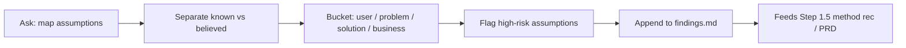

# Assumption mapper — how it works

The **assumption-mapper** skill surfaces what the team believes versus what
it can source — before research or a build locks in a direction.

Agents load the full protocol from
[`harness/skills/assumption-mapper/SKILL.md`](SKILL.md).

---

## Quick reference

| What | Path |
|------|------|
| Agent skill | `harness/skills/assumption-mapper/SKILL.md` |
| Routing entry | `harness/ORCHESTRATOR.md` §2 |
| Composed by | `design-kickoff` Step 0/1 |
| Feeds | `design-kickoff` Step 1.5 · PRD “Assumptions & open questions” |
| Sibling | [`decision-first-research`](../decision-first-research/GUIDE.md) |

---

## What problem it solves

Teams often start research or a prototype to **confirm** a decision already
made. This skill forces a clean split: sourced “known” vs unsourced
“believed,” across user / problem / solution / business buckets, so the
next step is designed to learn.

---

## What it does NOT do

- Does **not** run interviews, UTs, or a Confluence discovery draft
- Does **not** open a net-new project alone — `design-kickoff` is the front door
- Does **not** say research “validated” an assumption — only explored /
  supported / contradicted

---

## What you say (plain language)

Any of these should route here:

- “Map our assumptions about referral entry points”
- “Assumption audit before we kick off settings IA”
- “We think we know what providers want — separate known from believed”
- “Hypothesis vs assumption for this redesign”
- “Before we start, what should we document as assumptions?”

**Situations (use cases):**

| Situation | What you say |
|-----------|----------------|
| Starting a kickoff and the team already “knows” the answer | “Map assumptions before we draft the PRD” |
| Stakeholder brief reads like confirmation research | “Challenge these assumptions — what's sourced vs believed?” |
| Mid-project, a new open question appears | “Assumption audit for [this new question] on the existing task” |

Orchestrator routes these to **`assumption-mapper`**. On a brand-new topic
with no folder yet, `design-kickoff` runs first and composes this skill
internally.

Acceptance walkthrough: [`tests/scenarios.md`](../../../tests/scenarios.md)
Scenario 19.

---

## Flow

---

## Related

| Doc | Role |
|-----|------|
| [`how-the-harness-works.md`](../../../documentation/guides/how-the-harness-works.md) | Full skill roster |
| [`research-question-sharpener`](../research-question-sharpener/GUIDE.md) | Next: turn goals into real questions |
| [`decision-first-research`](../decision-first-research/GUIDE.md) | When the ask is still vague / time-boxed |
| [`build-a-skill.md`](../../../documentation/maintainers/build-a-skill.md) | New skill → HOWTO rule |
