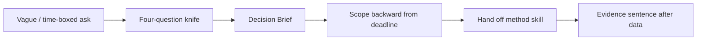

# Decision-first research — how it works

The **decision-first-research** skill scopes a research request around the
**decision it must unblock** — not the method someone named. It produces a
Decision Brief and an evidence-formula sentence (“ship X, backed by Y, to
reduce Z risk”).

Agents load the full protocol from
[`harness/skills/decision-first-research/SKILL.md`](SKILL.md).

---

## Quick reference

| What | Path |
|------|------|
| Agent skill | `harness/skills/decision-first-research/SKILL.md` |
| Routing entry | `harness/ORCHESTRATOR.md` §2 |
| Feeds | `design-kickoff` Step 1.5 · [`usability-test-guide`](../usability-test-guide/GUIDE.md) · [`ia-methods`](../ia-methods/GUIDE.md) · [`screener-builder`](../screener-builder/GUIDE.md) |
| Out of scope | Generative / vision / slow-burn discovery |

---

## What problem it solves

Good research gets ignored when it answers a question nobody was deciding.
This skill forces: the call, the window, the risk if wrong, what’s already
known, and the **one** blocking unknown — then the lightest study that fits
the deadline.

---

## What it does NOT do

- Does **not** replace open-ended generative discovery — say so and don’t force a Decision Brief
- Does **not** pick the final method alone — hands a named decision to Step 1.5
- Does **not** extend the timeline to fit a bigger study — cut scope instead

---

## What you say (plain language)

Any of these should route here:

- “We have a week for research — how do we scope this?”
- “Stakeholder asked for a survey but didn’t say what decision it’s for”
- “Write a decision brief for this”
- “My research isn’t getting used — help me reframe the ask”
- “How do I say no to a vague research request?”

**Situations (use cases):**

| Situation | What you say |
|-----------|----------------|
| “Just run a survey” with a Friday deadline | “Decision brief — what’s the call and the risk if wrong?” |
| Research keeps sitting unused | “Reframe this around the decision it unblocks” |
| Leadership wants N=300 in five days | “Trade method for window — lightest evidence that fits” |

Acceptance walkthrough: [`tests/scenarios.md`](../../../tests/scenarios.md)
Scenario 25.

---

## Flow

---

## Related

| Doc | Role |
|-----|------|
| [`assumption-mapper`](../assumption-mapper/GUIDE.md) | Known vs believed before framing |
| [`usability-test-guide`](../usability-test-guide/GUIDE.md) | Common method handoff |
| [`ia-methods`](../ia-methods/GUIDE.md) | Structural / IA unknowns |
| [`how-the-harness-works.md`](../../../documentation/guides/how-the-harness-works.md) | Roster |
| [`build-a-skill.md`](../../../documentation/maintainers/build-a-skill.md) | New skill → HOWTO rule |
