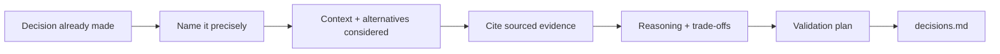

# Design rationale — how it works

The **design-rationale** skill writes down why an **already-made**
design decision was chosen — options considered, sourced evidence,
reasoning, trade-offs accepted, and a validation plan — so it survives
being questioned weeks or months later.

Agents load the full protocol from
[`harness/skills/design-rationale/SKILL.md`](SKILL.md).

---

## Quick reference

| What | Path |
|------|------|
| Agent skill | `harness/skills/design-rationale/SKILL.md` |
| Routing entry | `harness/ORCHESTRATOR.md` §2 |
| Persists to | `projects/<slug>/decisions.md` (same file as `ux-pattern`'s decision framework mode and `ui-agent`'s variant-fork) |
| Distinct from | `ux-pattern` decision framework (before pick); `accessibility-decisions` (a11y-specific ADR/handoff) |

---

## What problem it solves

A choice gets made, ships, and three weeks later someone asks "why did
we do it this way?" — and the answer lives only in someone's memory of
a Slack thread. This skill writes the defense down at the time of the
decision (or shortly after), with real evidence cited, not backfilled.

---

## What it does NOT do

- Does **not** weigh options that haven't been decided yet — that's
  `ux-pattern`'s decision framework mode; hand off there first
- Does **not** write rationale for routine, uncontested calls — reserve
  it for decisions someone could reasonably question
- Does **not** invent evidence to make a gut-feel call look researched
  — says "no evidence cited" plainly when that's the truth

---

## What you say (plain language)

Any of these should route here:

- "Write the rationale for this decision"
- "Why did we choose this over the alternative?"
- "Document why we went with inline text instead of a modal"
- "Defend this decision in writing — it'll get questioned later"
- "Explain the trade-offs on this choice"

**Situations (use cases):**

| Situation | What you say |
|-----------|----------------|
| Just shipped a debated change | "Write the rationale for moving the policy inline" |
| Anticipating pushback in a review | "Document why we chose this over the modal approach" |
| Onboarding a new teammate to old decisions | "What's the rationale behind [pattern]?" |

Acceptance walkthrough: [`tests/scenarios.md`](../../../tests/scenarios.md)
Scenario 28.

---

## Flow

---

## Related

| Doc | Role |
|-----|------|
| [`harness/skills/ux-pattern/SKILL.md`](../ux-pattern/SKILL.md) § Decision framework mode | Weighs options before the pick |
| [`insight-writer`](../insight-writer/GUIDE.md) | Source of research evidence when the decision is research-driven |
| [`accessibility-decisions`](../accessibility-decisions/GUIDE.md) | A11y-specific ADR / tradeoff / eng handoff (use instead of this for a11y) |
| [`harness/references/interaction-laws.md`](../../references/interaction-laws.md) | Citable principle-based evidence when the decision is craft-driven, not research-driven |
| [`how-the-harness-works.md`](../../../documentation/guides/how-the-harness-works.md) | Roster |
| [`build-a-skill.md`](../../../documentation/maintainers/build-a-skill.md) | New skill → HOWTO rule |
