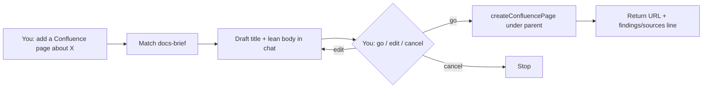

# Confluence brief — how it works

The **docs-brief** skill drafts a **scannable Confluence page**, then
creates it only after you say go. Long thinking stays in
`projects/<slug>/findings.md` — not pasted into the wiki.

Same posture as [ticket-create](../ticket-create/GUIDE.md) and
[scheduling](../scheduling/GUIDE.md): **propose → confirm → act.** On-demand
only — not a gate, not part of design-kickoff.

Agents load the full protocol from
[`harness/skills/docs-brief/SKILL.md`](SKILL.md).

---

## Quick reference

| What | Path |
|------|------|
| Agent skill | `harness/skills/docs-brief/SKILL.md` |
| Lean body template | `harness/skills/docs-brief/references/lean-body.md` |
| Space / parent defaults | `harness/skills/docs-brief/references/defaults.md` |
| Routing entry | `harness/ORCHESTRATOR.md` §2 |
| Sibling posture | `harness/skills/ticket-create/GUIDE.md` |

---

## "Didn't we already have this — the PRD skill?"

We have **two** Confluence writers, and they're not duplicates — they do
opposite jobs. This distinction matters, so read it once:

| | `research-agent` / `design-kickoff` (existing) | `docs-brief` (this skill) |
|---|---|---|
| **Job** | *Researches* a topic from zero | *Publishes* what's already decided |
| **Before writing** | Live sweep: Confluence + Jira + Slack + Figma + Miro | Nothing new — summarizes the conversation + `projects/<slug>/findings.md` |
| **Output** | 17-section PRD scaffold | 1-page lean brief (problem / have today / done so far / decisions+why / next / park / links) |
| **Destination** | Requester's **personal** Confluence space, **draft** | **Team folder you name**, **current** (published) |
| **Ask shape** | "tell me everything about X", "kick off discovery on X", "catch me up on X" | "add a wiki page under Referrals about what we've done" |

If you want fresh research → PRD path (`research-agent` / `design-kickoff`).
If you want to publish a status/why page for work already in flight →
this skill.

---

## What problem it solves

Without a skill, “add a Confluence page” fell to **FALLBACK → freestyle**
(overloaded bodies, or wrong route to `writing`). Team pages need the
same lean + confirm-first discipline as Jira tickets — and a name that
doesn't get confused with the PRD scaffold.

---

## What it does NOT do

- Does **not** auto-create without your go
- Does **not** paste findings, Slack, or Mobbin catalogs into the body
- Does **not** run a research sweep — that's `research-agent`
- Does **not** replace `writing` (essay / LinkedIn prose in chat)
- Does **not** create Jira tickets — that's `ticket-create`

---

## Flow



### Step by step

1. You paste a folder/page URL (or name the space/parent) and say what
   the page should cover.
2. Agent drafts **title + lean body** in chat, from what's already known.
3. You reply **go**, edit, or cancel.
4. Agent creates the page and returns the URL.
5. If a project folder is active: one line in `findings.md` +
   `sources.md`.

---

## When it runs

```
add a Confluence page under Referrals about entry points
put the why one-pager on Confluence in this folder
create a wiki page: what we have, what we did, ideas + why
document entry-points status for the team on Confluence
```

Orchestrator routes these to **`docs-brief`** per
`harness/ORCHESTRATOR.md` §2.

---

## Lean body shape

| Section | What goes there |
|---------|-----------------|
| **The problem** | 2–4 lines |
| **What we have today** | Live surfaces |
| **What we've done so far** | Dated milestones |
| **Decisions & why** | Table |
| **Ideas / next** | Near-term bullets |
| **Park for later** | Table |
| **Links** | Jira / Figma / related wiki |

Full template:
[`harness/skills/docs-brief/references/lean-body.md`](references/lean-body.md).

---

## MCP

| MCP | Required? |
|-----|-----------|
| **Atlassian (Confluence write)** | Yes, to create. If missing → draft in chat only. |

---

## Related

| Doc | Role |
|-----|------|
| [`ticket-create`](../ticket-create/GUIDE.md) | Twin skill for Jira |
| [`how-the-harness-works.md`](../../../documentation/guides/how-the-harness-works.md) | Routing + roster |
| [`harness/skills/research-agent/SKILL.md`](../research-agent/SKILL.md) | PRD/discovery Confluence drafts — the other job |
