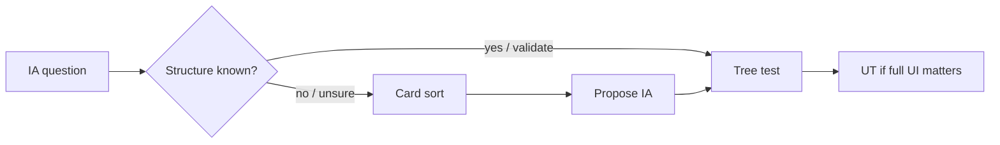

# IA methods — how it works

The **ia-methods** skill plans and analyzes **card sorting** (how users
categorize content) and **tree testing** (whether users can find content in
a navigation hierarchy). Recommended sequence: card sort → tree test →
usability test.

Agents load the full protocol from
[`harness/skills/ia-methods/SKILL.md`](SKILL.md).

---

## Quick reference

| What | Path |
|------|------|
| Agent skill | `harness/skills/ia-methods/SKILL.md` |
| Routing entry | `harness/ORCHESTRATOR.md` §2 |
| Routed from | `decision-first-research` (“card sort / tree test”) |
| Next after tree test | [`usability-test-guide`](../usability-test-guide/GUIDE.md) |

---

## What problem it solves

Navigation and IA questions aren’t answered by a generic UT or interview.
Card sorting reveals mental models; tree testing measures findability by
labels alone (directness often matters more than raw success).

---

## What it does NOT do

- Does **not** explain *why* users behave a certain way (interviews)
- Does **not** evaluate visual UI (`usability-test-guide`)
- Does **not** use the exact nav label inside a tree-test task (that tests reading, not findability)

---

## What you say (plain language)

Any of these should route here:

- “Plan a card sort for our settings navigation”
- “Build a tree test for this IA”
- “Can users find things in this nav — directness score?”
- “Information architecture research for filters”
- “Hybrid card sort — existing IA but labels feel wrong”

**Situations (use cases):**

| Situation | What you say |
|-----------|----------------|
| Redesigning nav / settings | “Card sort plan for [area] — hybrid, ~30 cards” |
| New IA drafted, need proof | “Tree test these labels — success + directness” |
| Mixed labels from a prior sort | “A/B two label options in a tree test” |

Acceptance walkthrough: [`tests/scenarios.md`](../../../tests/scenarios.md)
Scenario 26.

---

## Which method

| Ask | Use |
|-----|-----|
| How do users categorize / what labels? | Card sort (open / closed / hybrid) |
| Can they find it in this structure? | Tree test |
| Redesign with some existing IA | Hybrid card sort → tree test |

---

## Flow

---

## Related

| Doc | Role |
|-----|------|
| [`decision-first-research`](../decision-first-research/GUIDE.md) | Scopes structural unknowns here |
| [`usability-test-guide`](../usability-test-guide/GUIDE.md) | After structure is validated |
| [`how-the-harness-works.md`](../../../documentation/guides/how-the-harness-works.md) | Roster |
| [`build-a-skill.md`](../../../documentation/maintainers/build-a-skill.md) | New skill → HOWTO rule |
