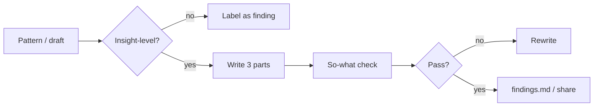

# Insight writer — how it works

The **insight-writer** skill turns a pattern into a real insight (key
learning + why + consequence) and pressure-tests drafts with a stakeholder
“so-what” check before anything ships.

Agents load the full protocol from
[`harness/skills/insight-writer/SKILL.md`](SKILL.md).

---

## Quick reference

| What | Path |
|------|------|
| Agent skill | `harness/skills/insight-writer/SKILL.md` |
| Routing entry | `harness/ORCHESTRATOR.md` §2 |
| Upstream | [`research-synthesis`](../research-synthesis/GUIDE.md) |
| Prose tells (separate) | [`harness/references/anti-ai-writing.md`](../../references/anti-ai-writing.md) |

---

## What problem it solves

Most “insights” are observations, findings, or feature wishes. Stakeholders
need something they can act on: what happened, why, and what breaks if you
ignore it — plus a directional recommendation. This skill writes that shape
and checks whether the output would actually land.

---

## What it does NOT do

- Does **not** find patterns in raw transcripts (`research-synthesis`)
- Does **not** force UT findings into insight shape — call them findings
- Does **not** invent business impact when there’s no data — say consequence is unclear

---

## What you say (plain language)

Any of these should route here:

- “Write this cluster up as an insight”
- “Is ‘users find checkout frustrating’ an insight or a finding?”
- “So-what check this report before I present”
- “Pressure test my findings — will this land with stakeholders?”
- “My insights feel shallow — rewrite with consequence”

**Situations (use cases):**

| Situation | What you say |
|-----------|----------------|
| Affinity clusters ready | “Turn the top patterns into insights” |
| Draft readout tomorrow | “So-what check the whole report” |
| Stakeholder said “so what?” | “Add consequence + recommendation to these findings” |

Acceptance walkthrough: [`tests/scenarios.md`](../../../tests/scenarios.md)
Scenario 23.

---

## Modes

| Mode | Job |
|------|-----|
| Write the insight | Key learning + why + consequence |
| So-what check | Five questions per insight + report-level checks (TL;DR, Pyramid, plain language) |

---

## Flow

---

## Related

| Doc | Role |
|-----|------|
| [`research-synthesis`](../research-synthesis/GUIDE.md) | Patterns in |
| [`writing`](../writing/GUIDE.md) | Long-form prose (different job) |
| [`how-the-harness-works.md`](../../../documentation/guides/how-the-harness-works.md) | Roster |
| [`build-a-skill.md`](../../../documentation/maintainers/build-a-skill.md) | New skill → HOWTO rule |
