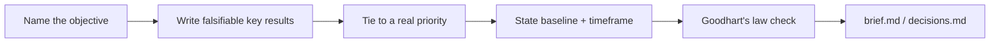

# OKR / goal setting — how it works

The **okr-goal-setting** skill writes a measurable objective + key
results (or a single north-star metric) for a design project — refusing
to invent baselines, targets, or business ties that don't actually
exist.

Agents load the full protocol from
[`harness/skills/okr-goal-setting/SKILL.md`](SKILL.md).

---

## Quick reference

| What | Path |
|------|------|
| Agent skill | `harness/skills/okr-goal-setting/SKILL.md` |
| Routing entry | `harness/ORCHESTRATOR.md` §2 |
| Persists to | `projects/<slug>/brief.md` or `decisions.md` |
| Distinct from | `harness/skills/roadmap-prioritization/SKILL.md` (consumes this skill's goal, doesn't produce it), `harness/skills/research-agent/SKILL.md` § Verdict synthesis mode (measures whether the metric moved) |

---

## What problem it solves

Design work often ships with no stated success measure, so nobody can
say afterward whether it worked beyond "looks good." This skill forces
a falsifiable key result — or an honest "not yet measurable, here's
what needs instrumenting first" — before the work is judged as done.

---

## What it does NOT do

- Does **not** invent a baseline or target that isn't actually tracked
  — flags "not yet instrumented" instead
- Does **not** treat "ship the thing" as a key result — that's a task,
  not an outcome
- Does **not** run the research/analytics that measures the metric —
  `research-agent` verdict-synthesis mode does that once data exists

---

## What you say (plain language)

- "Help me write an OKR for this project"
- "What should our goal be for X?"
- "What metric should we track for this?"
- "How do we know if this design actually worked?"

**Situations (use cases):**

| Situation | What you say |
|-----------|----------------|
| Starting a new initiative with no stated success measure | "What should our goal be for the referral entry-points project?" |
| A metric is proposed that seems gameable | "Is this KR going to reward the wrong behavior?" |
| Feeding a PRD's success criteria | "Write the OKR for this before we draft the PRD" |

Acceptance walkthrough: [`tests/scenarios.md`](../../../tests/scenarios.md)
Scenario 33.

---

## Flow

---

## Related

| Doc | Role |
|-----|------|
| [`roadmap-prioritization`](../roadmap-prioritization/GUIDE.md) | Consumes this skill's goal as a ranking input |
| [`harness/skills/design-kickoff/SKILL.md`](../design-kickoff/SKILL.md) | A goal from this skill can feed a PRD's success criteria |
| [`how-the-harness-works.md`](../../../documentation/guides/how-the-harness-works.md) | Roster |
| [`build-a-skill.md`](../../../documentation/maintainers/build-a-skill.md) | New skill → HOWTO rule |
