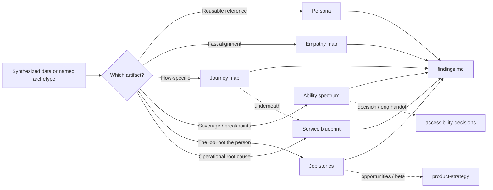

# Research artifacts — how it works

The **research-artifacts** skill turns synthesized research (or a named
the company archetype) into the artifact a stakeholder actually looks at —
a **persona**, an **empathy map**, a **journey map**, an
**ability-spectrum** map, **job stories**, or a **service blueprint**.
Six modes, one skill, because they share a rule: sourced data only,
never invented (and never invented disability lived experience).

Agents load the full protocol from
[`harness/skills/research-artifacts/SKILL.md`](SKILL.md).

---

## Quick reference

| What | Path |
|------|------|
| Agent skill | `harness/skills/research-artifacts/SKILL.md` |
| Routing entry | `harness/ORCHESTRATOR.md` §2 |
| Usual source | `harness/skills/research-synthesis/SKILL.md` output, or `COMPANY-ARCHETYPES.md` |
| Out of scope | a11y *decisions* → `accessibility-decisions`; service blueprints without a journey map underneath (run Mode 3 first) |

---

## What problem it solves

`research-synthesis` finds patterns and `insight-writer` writes the
insight behind them — but neither produces the artifact a team actually
shares in a review: a persona card, an empathy-map board, a journey map
with an emotional arc, or a spectrum showing where a feature starts to
exclude people. This skill closes that gap without inventing anything —
every quote, behavior, and ability claim has to trace back to real data,
an existing archetype, or an explicitly labeled situational the company
context.

---

## What it does NOT do

- Does **not** find the pattern itself — that's `research-synthesis`
- Does **not** write the insight/consequence behind a pattern — that's
  `insight-writer`
- Does **not** document a11y engineering decisions / tradeoffs / handoff —
  that's `accessibility-decisions`
- Does **not** map multi-channel/backstage service delivery (staff +
  systems across channels) — flags that as out of scope rather than
  stretching a journey map to cover it
- Does **not** invent a persona (or a disability) when there's no data —
  routes to `research-synthesis`/`research-agent` / recruiting first

---

## What you say (plain language)

Any of these should route here:

- "Build a persona from this research"
- "Make an empathy map for this segment"
- "Map this user's journey through checkout"
- "Who are we actually designing for here?"
- "Journey map for the cancellation flow"
- "Ability spectrum for the accept-referral sheet"
- "Who can and can't use this feature?"
- "Inclusive persona — weave situational impairment in"
- "Write job stories for the referral share flow"
- "What's the JTBD for this cancellation screen?"
- "Service blueprint for the cancellation flow — why does this keep breaking backstage?"
- "This pain point isn't a UI problem, map the operational root cause"

**Situations (use cases):**

| Situation | What you say |
|-----------|----------------|
| Just finished synthesizing 12 interviews, need a shareable summary | "Build a persona from the manual-tracking-provider pattern" |
| Quick team alignment before a workshop | "Empathy map for this segment — Says/Thinks/Does/Feels" |
| Redesigning a specific flow, need to see where it hurts | "Journey map this booking flow for [persona]" |
| Stakeholder asks "our users aren't disabled" / coverage gaps | "Ability spectrum — where does accept referral fail?" |
| Persona feels ability-blind | "Inclusive persona pass — permanent/temporary/situational dimensions" |
| Know who, not the job they're hiring for | "Job stories for this flow — when / I want to / so I can" |
| Journey map found a pain point that's clearly not a UI problem | "Service blueprint — trace this to its operational root cause" |

Acceptance walkthrough: [`tests/scenarios.md`](../../../tests/scenarios.md)
Scenario 27 (persona/journey), Scenario 27b (job stories), and Scenario 67 (ability spectrum).

---

## Which mode

| Ask | Use |
|-----|-----|
| Need a memorable, reusable reference for a segment | Persona (+ inclusive dimension when asked/data supports) |
| Fast, low-ceremony alignment snapshot | Empathy map |
| Visualize stages/emotions/pain points through a flow | Journey map |
| Coverage / breakpoints / who gets excluded | Ability spectrum |
| Situation → motivation → outcome (the job, not the person) | Job stories |

---

## Flow

---

## Related

| Doc | Role |
|-----|------|
| [`research-synthesis`](../research-synthesis/GUIDE.md) | Usual source of the patterns this skill turns into artifacts |
| [`insight-writer`](../insight-writer/GUIDE.md) | Different output — the insight, not the understanding artifact |
| [`documentation/skills/product-strategy.md`](../../../documentation/skills/product-strategy.md) | Consumes job stories as opportunities — does not write them |
| [`accessibility-decisions`](../accessibility-decisions/GUIDE.md) | After spectrum finds a breakpoint that needs a recorded pick |
| [`how-the-harness-works.md`](../../../documentation/guides/how-the-harness-works.md) | Roster |
| [`build-a-skill.md`](../../../documentation/maintainers/build-a-skill.md) | New skill → HOWTO rule |
