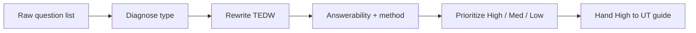

# Research question sharpener — how it works

The **research-question-sharpener** skill rewrites vague or unanswerable
stakeholder questions into story-based ones that can actually produce
usable data — and flags questions qualitative research can’t answer.

Agents load the full protocol from
[`harness/skills/research-question-sharpener/SKILL.md`](SKILL.md).

---

## Quick reference

| What | Path |
|------|------|
| Agent skill | `harness/skills/research-question-sharpener/SKILL.md` |
| Routing entry | `harness/ORCHESTRATOR.md` §2 |
| Feeds | [`usability-test-guide`](../usability-test-guide/GUIDE.md) |
| Upstream | [`assumption-mapper`](../assumption-mapper/GUIDE.md) |

---

## What problem it solves

Stakeholder lists are often shallow (“Are you satisfied?”), jargon-heavy,
future-based (“Would you use this?”), leading, or positive-only. Running
them as-is wastes sessions. This skill diagnoses each question, rewrites
via TEDW (Tell / Explain / Describe / Walk me through), and redirects
what belongs in A/B, survey, or pricing research.

---

## What it does NOT do

- Does **not** build the full session script — that’s `usability-test-guide`
- Does **not** invent questions with no list or goals to sharpen
- Does **not** claim a small qual sample can answer prevalence / statistical significance

---

## What you say (plain language)

Any of these should route here:

- “Sharpen these research questions”
- “A stakeholder sent me this list — are these any good?”
- “Which of these should I actually ask in the interview?”
- “Rewrite these so they’re not yes/no”
- “This question isn’t answerable in an interview — what do I do?”

**Situations (use cases):**

| Situation | What you say |
|-----------|----------------|
| PM dumps a 20-question list | “Prioritize and sharpen this list for a 60-min session” |
| Questions are all “would you use…” | “Flip these future-based questions to past behavior” |
| Someone asks for pricing in a qual interview | “Flag what can’t be answered as qual and redirect” |

Acceptance walkthrough: [`tests/scenarios.md`](../../../tests/scenarios.md)
Scenario 20.

---

## Flow

---

## Related

| Doc | Role |
|-----|------|
| [`usability-test-guide`](../usability-test-guide/GUIDE.md) | Builds the session from sharpened questions |
| [`assumption-mapper`](../assumption-mapper/GUIDE.md) | Often produces the research goals this sharpens |
| [`how-the-harness-works.md`](../../../documentation/guides/how-the-harness-works.md) | Roster |
| [`build-a-skill.md`](../../../documentation/maintainers/build-a-skill.md) | New skill → HOWTO rule |
