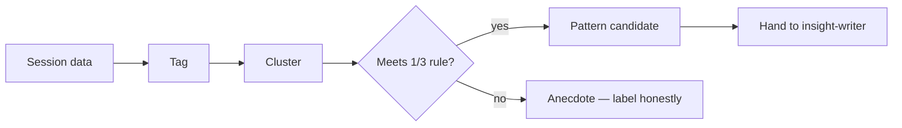

# Research synthesis — how it works

The **research-synthesis** skill turns raw interview / UT notes and
transcripts into tagged clusters and pattern candidates — via a short
post-session debrief, lightning synthesis, or a full tag + affinity pass.

Agents load the full protocol from
[`harness/skills/research-synthesis/SKILL.md`](SKILL.md).

---

## Quick reference

| What | Path |
|------|------|
| Agent skill | `harness/skills/research-synthesis/SKILL.md` |
| Routing entry | `harness/ORCHESTRATOR.md` §2 |
| Upstream | [`usability-test-guide`](../usability-test-guide/GUIDE.md) |
| Downstream | [`insight-writer`](../insight-writer/GUIDE.md) |
| Pattern rule | ~1/3 of sample (rounded up) |

---

## What problem it solves

Without synthesis, teams argue from memory and confirmation bias. This
skill makes patterns visible — with participant numbers on every data
point — and stops short of polished insights so you don’t confuse a
cluster with a decision-ready writeup.

---

## What it does NOT do

- Does **not** write finished insights (`insight-writer`)
- Does **not** invent patterns from one or two comments
- Does **not** pick the research method (`decision-first-research` / `design-kickoff` Step 1.5)

---

## What you say (plain language)

Any of these should route here:

- “Run a debrief for the session we just finished”
- “Synthesize these six interview transcripts”
- “Affinity diagram this data — find the patterns”
- “I have all this data, now what?”
- “Lightning synthesis after each interview — we’re short on time”

**Situations (use cases):**

| Situation | What you say |
|-----------|----------------|
| Stakeholders watched the session | “30-min debrief board for participant 3” |
| Study finished, pile of notes | “Full tag + affinity — show pattern candidates” |
| Need speed mid-study | “Lightning synthesis per participant from here on” |

Acceptance walkthrough: [`tests/scenarios.md`](../../../tests/scenarios.md)
Scenario 22.

---

## Modes (pick one)

| Mode | When | Time |
|------|------|------|
| Post-session debrief | Stakeholders observed live; keep momentum | ~30 min / session |
| Lightning synthesis | Time-pressed; tag + cluster + draft material per participant | ~35 min / session |
| Full tag + affinity | Study complete; need cross-participant patterns | Hours, not minutes |

---

## Flow

---

## Related

| Doc | Role |
|-----|------|
| [`insight-writer`](../insight-writer/GUIDE.md) | Key learning + why + consequence |
| [`usability-test-guide`](../usability-test-guide/GUIDE.md) | Sessions this synthesizes |
| [`how-the-harness-works.md`](../../../documentation/guides/how-the-harness-works.md) | Roster |
| [`build-a-skill.md`](../../../documentation/maintainers/build-a-skill.md) | New skill → HOWTO rule |
