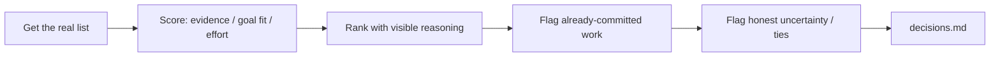

# Roadmap prioritization — how it works

The **roadmap-prioritization** skill turns a flat list of design tasks
into a ranked order, scored on evidence strength, goal fit, and honest
effort — with the reasoning always visible, never a bare ranked list.

Agents load the full protocol from
[`harness/skills/roadmap-prioritization/SKILL.md`](SKILL.md).

---

## Quick reference

| What | Path |
|------|------|
| Agent skill | `harness/skills/roadmap-prioritization/SKILL.md` |
| Routing entry | `harness/ORCHESTRATOR.md` §2 |
| Persists to | `projects/<slug>/decisions.md` when tied to an active task |
| Distinct from | `harness/skills/workload-agent/SKILL.md` (reports what exists; this ranks it), `harness/skills/design-kickoff/SKILL.md` (decides *what* to build; this ranks already-scoped items) |

---

## What problem it solves

Backlogs get worked in the order they arrived, or whoever asked
loudest, not the order that actually matters. This skill forces a
visible, defensible order against real inputs (evidence, a stated goal,
effort) instead of a gut-feel queue.

---

## What it does NOT do

- Does **not** decide *what* to build on net-new, unscoped work — that's
  `design-kickoff`'s front door
- Does **not** invent evidence, goals, or effort sizes to look more
  rigorous than the real inputs support
- Does **not** silently reorder work that's already committed/in-flight
  — flags the tension instead

---

## What you say (plain language)

- "Help me prioritize this backlog"
- "Which of these should I do first?"
- "Rank these tickets"
- "We have 5 things and no time this sprint, which matters most?"

**Situations (use cases):**

| Situation | What you say |
|-----------|----------------|
| Overloaded sprint, need a defensible order | "I have 5 things on my plate — help me figure out what matters first" |
| Stakeholder questions the order | "Why is X above Y? Show me the reasoning" |
| Ranking against a stated goal | "Prioritize these against the referral-growth OKR" |

Acceptance walkthrough: [`tests/scenarios.md`](../../../tests/scenarios.md)
Scenario 32.

---

## Flow

---

## Related

| Doc | Role |
|-----|------|
| [`harness/skills/workload-agent/SKILL.md`](../workload-agent/SKILL.md) | Source of what's already committed/in-flight |
| [`okr-goal-setting`](../okr-goal-setting/GUIDE.md) | Source of the goal this skill ranks work against |
| [`insight-writer`](../insight-writer/GUIDE.md) | Evidence-strength input |
| [`how-the-harness-works.md`](../../../documentation/guides/how-the-harness-works.md) | Roster |
| [`build-a-skill.md`](../../../documentation/maintainers/build-a-skill.md) | New skill → HOWTO rule |
