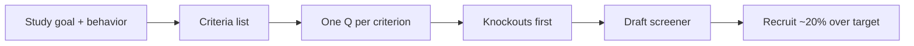

# Screener builder — how it works

The **screener-builder** skill builds a recruitment screener that filters
for the right participants by **behavior**, not demographics — criteria,
5–10 questions, knockout logic early.

Agents load the full protocol from
[`harness/skills/screener-builder/SKILL.md`](SKILL.md).

---

## Quick reference

| What | Path |
|------|------|
| Agent skill | `harness/skills/screener-builder/SKILL.md` |
| Routing entry | `harness/ORCHESTRATOR.md` §2 |
| Upstream | [`decision-first-research`](../decision-first-research/GUIDE.md) · method already chosen |
| Downstream | [`usability-test-guide`](../usability-test-guide/GUIDE.md) · sessions |

---

## What problem it solves

Wrong participants destroy a study faster than a weak guide. Demographic-only
screeners (age, gender, city) don’t predict useful session data. This skill
recruits for what people have **done**, how often, and how recently.

---

## What it does NOT do

- Does **not** design the session (`usability-test-guide`)
- Does **not** choose the research method
- Does **not** lead with demographics unless the study design truly requires them

---

## What you say (plain language)

Any of these should route here:

- “Write me a screener for this UT”
- “Help me recruit people who've abandoned cart in the last month”
- “Participant criteria for the referral interviews”
- “Screener questions — behavior first, not demographics”
- “Who should I recruit for this study?”

**Situations (use cases):**

| Situation | What you say |
|-----------|----------------|
| UT scheduled, no panel yet | “Screener for [behavior] in the last [timeframe]” |
| Non-users / competitor users | “Recruit non-users who use [competitor] regularly” |
| Screener too long / drop-off | “Cut this to 5–10 questions with knockouts first” |

Acceptance walkthrough: [`tests/scenarios.md`](../../../tests/scenarios.md)
Scenario 24.

---

## Flow

---

## Related

| Doc | Role |
|-----|------|
| [`usability-test-guide`](../usability-test-guide/GUIDE.md) | Session after recruit |
| [`decision-first-research`](../decision-first-research/GUIDE.md) | Sample size / method window |
| [`how-the-harness-works.md`](../../../documentation/guides/how-the-harness-works.md) | Roster |
| [`build-a-skill.md`](../../../documentation/maintainers/build-a-skill.md) | New skill → HOWTO rule |
