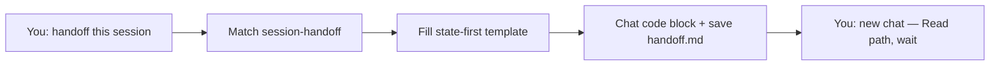

# Session handoff — how it works

The **session-handoff** skill compacts the current chat into a short,
state-first handoff so a **fresh agent session** can continue without
re-asking, re-discovering, or repeating traps.

Long thinking stays in `projects/<slug>/` (`brief`, `findings`,
`decisions`, `log`). The handoff **points** at those files — it does
not re-paste them.

Agents load the full protocol from
[`harness/skills/session-handoff/SKILL.md`](SKILL.md).

---

## Quick reference

| What | Path |
|------|------|
| Agent skill | `harness/skills/session-handoff/SKILL.md` |
| Preferred save location | `projects/<slug>/handoff.md` |
| No-task fallback | `designer-context.local/session-handoff.md` (if present) |
| Routing entry | `harness/ORCHESTRATOR.md` §2 |

---

## What problem it solves

Long Design Harness builds, critiques, and research threads fill context. Starting
a new chat without a handoff means the next agent re-discovers decisions
and dead ends — or invents status.

This skill makes "continue in a fresh chat" a **routed, state-first**
path instead of a freestyle essay dump.

---

## What it does NOT do

- Does **not** write a developer spec (`design-handoff` →
  `handoff-spec.md`)
- Does **not** replace the onboarding **handoff menu** (pick next work
  after profile setup)
- Does **not** run a `design-retrospective` (post-ship learning)
- Does **not** invent DONE / PARTIAL status — points at task files
- Does **not** auto-fire when the chat gets long — you ask
- Does **not** put secrets, tokens, or PII in the handoff

---

## Flow



### Step by step

1. You ask in plain language (examples below).
2. Agent loads `session-handoff`, fills the template from this session +
   task folder pointers.
3. You get one copy-paste block in chat **and** a saved file when a
   project slug is known.
4. In a fresh chat, paste: read that path, verify claims, wait for
   instructions.

---

## What you say (plain language)

```
handoff this session
write a handoff for a fresh chat
context is full — compact this
session handoff for account-settings
continue in a new chat — write the handoff first
```

---

## Situations

| Situation | Use session-handoff? |
|-----------|----------------------|
| Context full / switching chats mid-task | Yes |
| End of day; want tomorrow's agent to continue | Yes |
| Post-ship "what did we learn" | No → `design-retrospective` |
| Just finished onboarding; pick next work | No → onboarding handoff menu |
| Stakeholder readout | No → `research-shareout` / `deck-builder` |

---

## When it runs

Orchestrator routes the phrases above to **`session-handoff`** per
`harness/ORCHESTRATOR.md` §2. On-demand only.

---

## Related

| Doc | Role |
|-----|------|
| [`how-the-harness-works.md`](../../../documentation/guides/how-the-harness-works.md) | How routing works |
| [`projects/README.md`](../../../projects/README.md) | Task folder schema |
| [`design-retrospective`](../design-retrospective/GUIDE.md) | Different "close out" job |
| Acceptance scenario | [`tests/scenarios.md`](../../../tests/scenarios.md) Scenario 66 |
