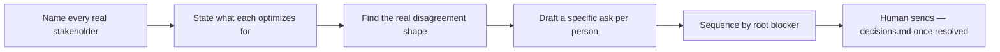

# Stakeholder alignment — how it works

The **stakeholder-alignment** skill maps who needs to agree with a
direction, what each of them actually optimizes for (sourced vs.
inferred, labeled honestly), where the real disagreement lives, and
drafts a sequenced, specific ask per stakeholder — never sent without
an explicit go.

Agents load the full protocol from
[`harness/skills/stakeholder-alignment/SKILL.md`](SKILL.md).

---

## Quick reference

| What | Path |
|------|------|
| Agent skill | `harness/skills/stakeholder-alignment/SKILL.md` |
| Routing entry | `harness/ORCHESTRATOR.md` §2 |
| Persists to | `projects/<slug>/decisions.md` once alignment is reached |
| Distinct from | `harness/skills/manager-1on1-prep/SKILL.md` (manager-gated, one-report status), `harness/skills/design-rationale/SKILL.md` (documents *after* alignment, not before) |

---

## What problem it solves

Stalled design reviews usually look like a taste disagreement but are
actually an unnamed incentive mismatch (risk tolerance, scope, a past
incident, an unstated cost). This skill names the real shape before
drafting an ask, so the ask actually speaks to what's blocking each
person — instead of one generic pitch sent to everyone.

---

## What it does NOT do

- Does **not** draft or send anything on the designer's behalf without
  an explicit go — it maps and drafts, a human sends
- Does **not** run manager 1:1 prep for a single named report — that's
  `manager-1on1-prep`, gated to manager profiles
- Does **not** document a decision that's already final — that's
  `design-rationale`, used *after* this skill gets to yes

---

## What you say (plain language)

- "How do I get buy-in on this?"
- "PM and eng disagree on this direction — help me align them"
- "This keeps stalling in review"
- "Who do I need on board for this?"

**Situations (use cases):**

| Situation | What you say |
|-----------|----------------|
| Cross-functional stall | "PM wants the full redesign now, eng wants to stage it — help me align them" |
| Unclear who actually needs to sign off | "Who do I need on board before this ships?" |
| Anticipating pushback before a review | "How do I convince [name] this is the right call?" |

Acceptance walkthrough: [`tests/scenarios.md`](../../../tests/scenarios.md)
Scenario 34.

---

## Flow

---

## Related

| Doc | Role |
|-----|------|
| [`harness/skills/manager-1on1-prep/SKILL.md`](../manager-1on1-prep/SKILL.md) | Manager-gated, one-report status prep — different shape |
| [`design-rationale`](../design-rationale/GUIDE.md) | Documents the decision once alignment is reached |
| [`COMPANY-SQUADS.md`](../../../context/org-pack/COMPANY-SQUADS.md) | Source for squad/PM/EM names when mapping stakeholders |
| [`how-the-harness-works.md`](../../../documentation/guides/how-the-harness-works.md) | Roster |
| [`build-a-skill.md`](../../../documentation/maintainers/build-a-skill.md) | New skill → HOWTO rule |
