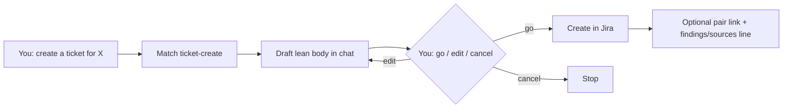

# Ticket create — how it works

The **ticket-create** skill drafts a **short Jira work order**, then
creates it only after you say go. Long thinking stays in
`projects/<slug>/findings.md` — not in the ticket description.

Same posture as [scheduling](../scheduling/GUIDE.md): **propose → confirm →
act.** On-demand only — not a gate, not part of design-kickoff.

Agents load the full protocol from
[`harness/skills/ticket-create/SKILL.md`](SKILL.md).

---

## Quick reference

| What | Path |
|------|------|
| Agent skill | `harness/skills/ticket-create/SKILL.md` |
| Lean body template | `harness/skills/ticket-create/references/lean-body.md` |
| Board / Team defaults | `harness/skills/ticket-create/references/defaults.md` |
| Routing entry | `harness/ORCHESTRATOR.md` §2 |
| Sibling posture | `harness/skills/scheduling/GUIDE.md` |

---

## What problem it solves

Creating tickets from chat without a skill produced **overloaded
descriptions** (meeting essays, "imo", lab dumps). Eng and PM need a
scannable work order; the lab already has `findings.md` for depth.

This skill makes "file a DES / ENG" a **routed, lean, confirm-first**
path instead of silent freestyle.

---

## What it does NOT do

- Does **not** auto-create without your go
- Does **not** paste findings, Slack, or Mobbin catalogs into the body
- Does **not** replace `design-kickoff` / PRDs
- Does **not** groom sprints, invent epics, or assign people you didn't name
- Does **not** answer "what's on my board" — that's `workload-agent`

---

## Flow



### Step by step

1. You ask in plain language (examples below).
2. Agent loads `ticket-create` and drafts **summary + lean body** (and a
   second draft if you asked for design + eng).
3. You reply **go**, edit a line, or cancel.
4. Agent creates the issue(s), links a pair if needed, returns URLs.
5. If a project folder is active: one line in `findings.md` +
   `sources.md`.

---

## When it runs

Say what you want — no slash command required:

```
create a design ticket for in-app referral entry points
file DES + ENG for profile banner placement
open an eng story blocked on the design ticket
draft a lean ENG for X — don't create yet
```

Orchestrator routes these to **`ticket-create`** per
`harness/ORCHESTRATOR.md` §2.

---

## Lean body shape

Every draft uses:

| Section | What goes there |
|---------|-----------------|
| **Why** | 2–3 lines |
| **In scope** | Short bullets |
| **Out of scope** | Max ~3 bullets |
| **Links** | Sister ticket, Figma, prior Done ticket |
| **Done when** | One sentence |

Optional: `Details: projects/<slug>/findings.md`

**Forbidden in the body:** chat voice ("imo", "I think"), meeting
retellings, research dumps.

Full template:
[`harness/skills/ticket-create/references/lean-body.md`](references/lean-body.md).

---

## Defaults (engagement / referrals)

| Board | Type | Team |
|-------|------|------|
| **DES** (design) | UX task | **the engagement team** when referrals |
| **ENG** (eng) | Story (or Task for tracking-only) | usually unset |

**Design + eng pair:** create DES first → create ENG → link **Blocks**
(design blocks eng).

IDs and API notes:
[`harness/skills/ticket-create/references/defaults.md`](references/defaults.md).

---

## Example (trimmed live tickets)

After this skill's standard was applied by hand:

- Design: [DES-190](https://your-org.atlassian.net/browse/DES-190)
- Eng: [ENG-3732](https://your-org.atlassian.net/browse/ENG-3732)

Those bodies are the target shape: Why / In / Out / Links / Done when.

---

## MCP

| MCP | Required? |
|-----|-----------|
| **Atlassian (Jira)** | Yes, to create. If missing → draft in chat only. |

Not part of the four-MCP onboarding gate as a *new* requirement — Jira
was already in Atlassian. This skill just refuses to invent keys without
it.

---

## Related

| Doc | Role |
|-----|------|
| [`how-the-harness-works.md`](../../../documentation/guides/how-the-harness-works.md) | How skills + routing fit together |
| [`scheduling`](../scheduling/GUIDE.md) | Same draft→confirm pattern |
| [`company-sources.md`](../../../documentation/guides/company-sources.md) | Where deep links/synthesis live |
| [`build-a-skill.md`](../../../documentation/maintainers/build-a-skill.md) | How this skill was shaped |
