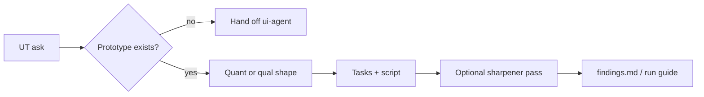

# Usability test guide — how it works

The **usability-test-guide** skill builds a session-ready usability test
plan — quantitative (task success, time, SEQ, SUS) or qualitative (TEDW
screen-by-screen) — against something real enough to task against.

Agents load the full protocol from
[`harness/skills/usability-test-guide/SKILL.md`](SKILL.md).

---

## Quick reference

| What | Path |
|------|------|
| Agent skill | `harness/skills/usability-test-guide/SKILL.md` |
| Routing entry | `harness/ORCHESTRATOR.md` §2 |
| Upstream | `design-kickoff` Step 1.5 · [`research-question-sharpener`](../research-question-sharpener/GUIDE.md) · [`screener-builder`](../screener-builder/GUIDE.md) |
| Downstream | [`research-synthesis`](../research-synthesis/GUIDE.md) |
| Does not build | Prototype → `ui-agent` |

---

## What problem it solves

“Let’s do a UT next week” with no tasks, metrics, or script produces
unusable sessions. This skill forces a clear quant vs qual shape, real
tasks, and a guide you can run — not a testing-101 essay.

---

## What it does NOT do

- Does **not** build the Design Harness prototype (`ui-agent`)
- Does **not** run the session or synthesize results (`research-synthesis` / `insight-writer`)
- Does **not** cover generative 1×1s, concept tests, or A/B — say so rather than stretching

---

## What you say (plain language)

Any of these should route here:

- “Write a usability test script for the checkout prototype”
- “Help me plan a UT for the referral entry points flow”
- “Build a UT plan — we have the Design Harness screens ready”
- “I need quant metrics for this flow (success, time, SEQ)”
- “Qual screen-by-screen feedback guide for this mid-fi”

**Situations (use cases):**

| Situation | What you say |
|-----------|----------------|
| Prototype ready, UT next week | “Plan a usability test for [slug] — tasks + script” |
| Need numbers for a stakeholder | “Quant UT guide — task success, time on task, SEQ” |
| Method-rec already said UT | “Build the UT guide from that recommendation” |

Fires from `design-kickoff` Step 1.5 when the recommended method is UT, or
standalone on an approved task with a prototype ready.

Acceptance walkthrough: [`tests/scenarios.md`](../../../tests/scenarios.md)
Scenario 21.

---

## Flow

---

## Related

| Doc | Role |
|-----|------|
| [`screener-builder`](../screener-builder/GUIDE.md) | Recruit the right people |
| [`research-synthesis`](../research-synthesis/GUIDE.md) | After sessions |
| [`ia-methods`](../ia-methods/GUIDE.md) | Card sort / tree test instead of UT |
| [`how-the-harness-works.md`](../../../documentation/guides/how-the-harness-works.md) | Roster |
| [`build-a-skill.md`](../../../documentation/maintainers/build-a-skill.md) | New skill → HOWTO rule |
