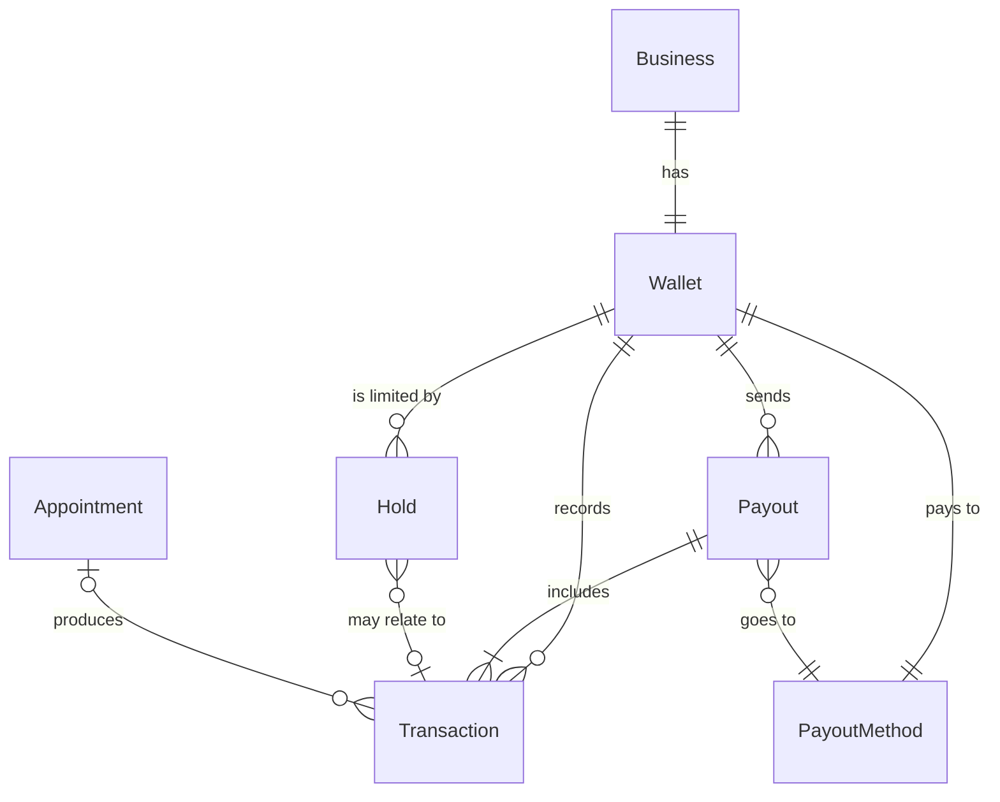
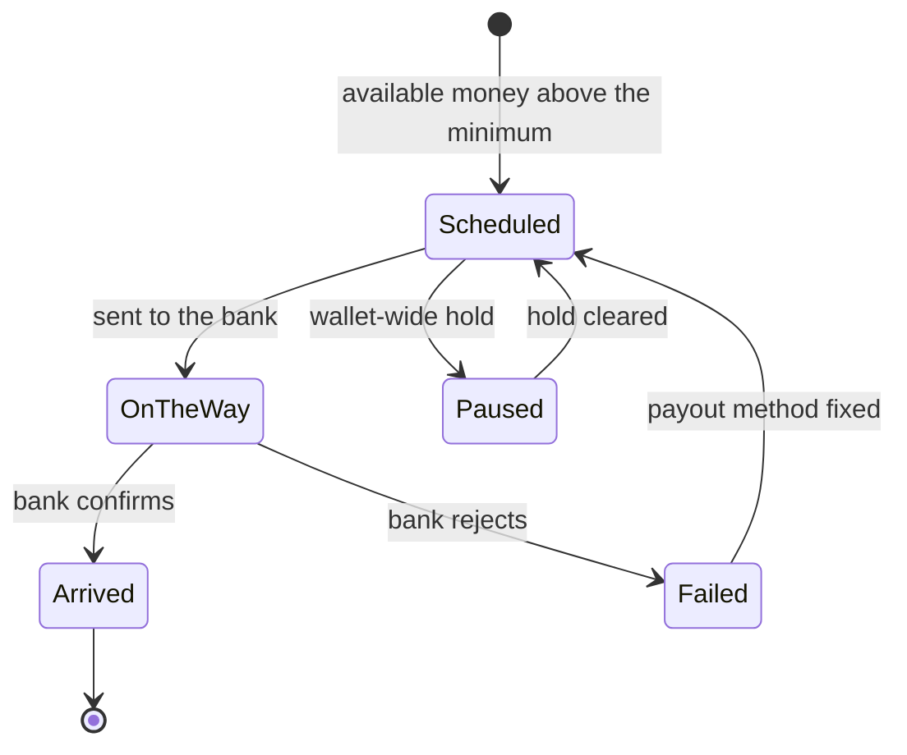

# Conceptual model — mobile-banking-dashboard

**Status:** Provisional (awaiting: a walk-through of the current wallet, and Finance on hold reasons)
**Created:** 2026-10-15
**Last updated:** 2026-10-15

Built from the approved PRD, `findings.md` 2026-10-15 and `COMPANY-VOCABULARY.md`. Nobody has walked the current wallet yet, so this is a hypothesis of what the wallet home should recognise, not a description of what ships today.

---

## Objects

- **Wallet** — the provider's money at Northline: what's come in, what's held, what's on its way to the bank. One per business.
- **Transaction** — one movement of money in or out of the wallet: a client payment, a tip, a refund, a transaction fee.
- **Payout** — one transfer of money from the wallet to the provider's bank.
- **Hold** — money, or the whole wallet, that Northline has stopped from paying out, with a reason and what clears it. *Provisional.*
- **Payout method** — the bank account or card payouts go to. Managed in the payment provider's portal; the wallet only shows it and links out.

Linked from outside this model: **Appointment** (a Transaction can come from one) and **Client**.

### Sorted nouns

| Noun (from findings) | Placement | Why |
|---|---|---|
| Balance | Attribute of Wallet | Not instanceable — one wallet has one balance, split into amounts below |
| Available / pending / on hold | Attribute values of Wallet | Three sums over Transactions and Holds |
| Tip, refund, chargeback, gift card payment, pay-later payment, transaction fee | Instances (types) of Transaction | Same shape — amount, date, source. Not separate objects |
| Payout minimum (€25), payout frequency | Attributes of Wallet (payout rules) | Settings on the wallet, not things the provider handles |
| "Blocked" | State of Wallet, caused by a Hold | User word for a wallet-wide hold |
| Bank statement | Set aside | Outside Northline; the job is to reconcile against it |
| Receipt | Set aside (view of a Transaction) | iOS already links wallet → receipt |
| Financing offer | Set aside | Out of PRD scope |

---

## Object definitions

### Object: Wallet

**What it is:** where a provider sees the money Northline holds for their business, and when it reaches their bank.

**Attributes:**
- `available` (money) — paid out at the next payout
- `pending` (money) — taken from clients but not yet available
- `on_hold` (money) — stopped by one or more Holds
- `currency` (code)
- `payout_rules` — frequency and minimum
- `status` (state)

**Relationships:**
- belongs to one Business
- has many Transactions
- has many Payouts
- has zero or many Holds
- has one Payout method

**Actions:**
- View balance
- View activity
- Go to payout method (opens the payment provider's portal)

**States:**
- **Active** — payouts run on schedule.
- **Payouts paused** — a wallet-wide Hold stops all payouts; money still comes in. Must show the reason and the next step (job story 1).
- **Not set up** — payments not activated or verification not finished.

**Provisional?** No — the wallet is live.

### Object: Transaction

**What it is:** one amount that changed the wallet, and where it came from.

**Attributes:**
- `type` — client payment, tip, refund, chargeback, transaction fee, adjustment
- `amount` (money, signed)
- `method` — card, tap to pay, gift card, pay-later
- `occurred_at` (date)
- `status` — pending or available

**Relationships:**
- belongs to one Wallet
- may come from one Appointment (and its Client)
- is included in zero or one Payout

**Actions:**
- View detail
- Open receipt
- Open appointment

**States:**
- **Pending** — not yet available
- **Available** — will go in the next Payout
- **Paid out** — part of a sent Payout

**Provisional?** No.

### Object: Payout

**What it is:** one transfer to the provider's bank, and exactly what made it up.

**Attributes:**
- `amount` (money)
- `expected_on` (date) and `arrived_on` (date)
- `status`
- `breakdown` — sums by Transaction type

**Relationships:**
- belongs to one Wallet
- includes one or many Transactions
- goes to one Payout method

**Actions:**
- View breakdown (job story 3)
- Find in bank (amount, date, reference)

**States:** see the diagram below.

**Provisional?** No.

### Object: Hold

**What it is:** a reason Northline isn't paying some money, or any money, out yet.

**Attributes:**
- `scope` — one amount, or the whole wallet
- `amount` (money, when scoped to an amount)
- `reason` — chargeback, verification, negative balance, risk review
- `next_step` — what clears it, and who acts (provider, Northline, the bank)
- `since` (date)

**Relationships:**
- belongs to one Wallet
- may relate to one Transaction (for example, the disputed payment)

**Actions:**
- View reason
- Take the next step (verify, respond to a dispute, add money)
- Contact support

**States:** Active → Cleared.

**Provisional?** **Yes.** Only first-class if the wallet receives the reason from the payment provider (PRD §7 Q2). If it doesn't, the home can only say "paused", and job story 1 stays unsolved.

---

## Relationships

## Payout states

- **Scheduled** — amount and date known; can still change if a refund or chargeback lands first. Say so.
- **Paused** — show the Hold's reason and next step. Never only "blocked".
- **On the way** — expected date shown.
- **Arrived** — amount and reference, so the provider can find it in their bank.
- **Failed** — what's wrong with the payout method, plus a link to fix it in the payment provider's portal.

---

## Ubiquitous language

| Concept | Chosen term | Rejected alternatives | Why | Used where |
|---|---|---|---|---|
| Transfer to the provider's bank | **Payout** | Deposit, withdrawal, transfer | "Deposits" already means upfront booking payments (Northline Holds, `COMPANY-VOCABULARY.md`) | Wallet UI, help, this model |
| Northline's cut of a payment | **transaction fee** | processing fee, commission | Company vocabulary rule | Breakdown, transaction list |
| Money ready for the next payout | **Available** | Balance, cleared | "Balance" is the total; the provider needs the part that is theirs to receive | Wallet home |
| Money taken but not yet available | **Pending** | Processing, incoming | Matches what providers already say ("pending payouts", 2026-10-13) | Wallet home, transactions |
| Money stopped from paying out | **On hold** | Blocked, frozen, reserved | "Blocked" reads as a punishment with no cause; "on hold" implies a reason and an end | Wallet home, hold detail |
| Wallet-wide stop | **Payouts paused** | Wallet blocked, restricted access | Says what stopped (payouts) and that money still comes in; "restricted access" is engineering language (iOS, 2026-09-22) | Wallet status |

Final UI wording goes through the `content` skill; this sets one concept per name.

---

## Temporal decisions

| Decision | Choice |
|---|---|
| Intermediate states | Pending → Available on transactions; Scheduled → On the way → Arrived on payouts. Both are model states and should be visible, not hidden behind a spinner |
| Read model lag | Wallet data may trail the payment provider. If pending payouts "vanish" (2026-10-13), the home should show when it was last updated. Engineering to confirm |
| History | Transactions never change. A refund or chargeback is a new Transaction, never an edit to the original |
| Deletion | Nothing in the wallet is deleted by the provider |
| Scheduled payout amount | Can change until sent. Show it as an estimate until it's On the way |
| Audit trail | Each Payout keeps its list of Transactions, so any deposit in the bank can be traced back |

## OOUX audit

From provider reports, not a walk-through:

- **Isolated** — Payout has no visible link to its Transactions: a €15 tip couldn't be found in a payout (2026-09-29). The model includes one or many Transactions; the home must surface it.
- **Broken** — Payout method lives in the payment provider's portal, apart from the wallet; providers get lost between apps (2026-09-15, 2026-10-08). The model keeps the link out but doesn't fix it.
- **Shapeshifter (possible)** — money appears in the wallet, in Reports → Cashflow (2026-10-06) and under Checkout-tab settings (A/B test). Check after the walk-through.
- **Masked** — not found.

---

## Open questions

- Does the wallet receive Hold reasons and next steps from the payment provider? (decides whether Hold is first-class)
- Are missing gift-card and pay-later payments a data problem? If so, the model is right and the data is wrong.
- Is "pending" one period (card settlement) or several (settlement plus dispute window)?
- Can a provider have more than one wallet (multi-location business)?
- "Northline Holds" is the deposit feature. Does "On hold" in the wallet read as that? Check with `content`.

## Next steps

- [ ] Walk the current wallet and compare it with this model (redesign technique)
- [ ] Ask Finance the open questions
- [ ] Design the wallet home on Wallet → Payout → Transaction, with Hold when confirmed
