# From one sentence to a case study: how the harness ran a wallet project

*Draft — needs your edit pass before publishing.*

*Northline is a fictional company invented for this harness. Every name, number and quote in this project is made up. The steps and questions are the real ones.*

I typed one sentence into Cursor: "I want to build a dashboard view for mobile banking." No brief, no Figma, no ticket. By the end of the afternoon the project had a brief, a conceptual model, an iOS wallet home, three error states, a storyboard, a case study and an article. This page walks through how that happened. It covers what the harness did on its own, every place it stopped to ask me something, what I answered, and what each answer changed.

The pattern repeats all the way through. The harness does the work it can do from what it already knows. Then it stops at a decision that belongs to the designer and asks it as a few clickable options. It never starts the next step without a yes.

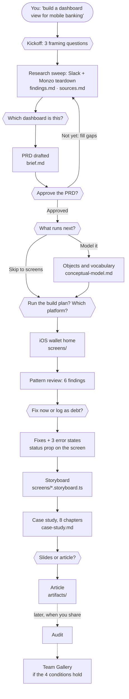

*The whole run on one page. Hexagons are the points where the harness stopped and asked me; boxes are work it did on its own, with the file it wrote. Each answer is recorded in `decisions.md`, and each request in `log.md`. The dotted part hasn't happened yet.*

## 1. Kickoff: three questions before anything else

A sentence like mine matches the harness's "new project" route, so it starts with `design-kickoff`. Before searching anything, it asked three framing questions in one panel:

- **What is this, in one line?** I picked "the app's home screen: balances, recent activity and quick actions".
- **Is there existing material you know of?** None.
- **Who's the PM or requester?** Me, my own initiative, no PM.

The harness created the project folder with its working files: the brief, findings, decisions, sources and a log. Every step after this writes into those files, so the story never depends on chat memory.

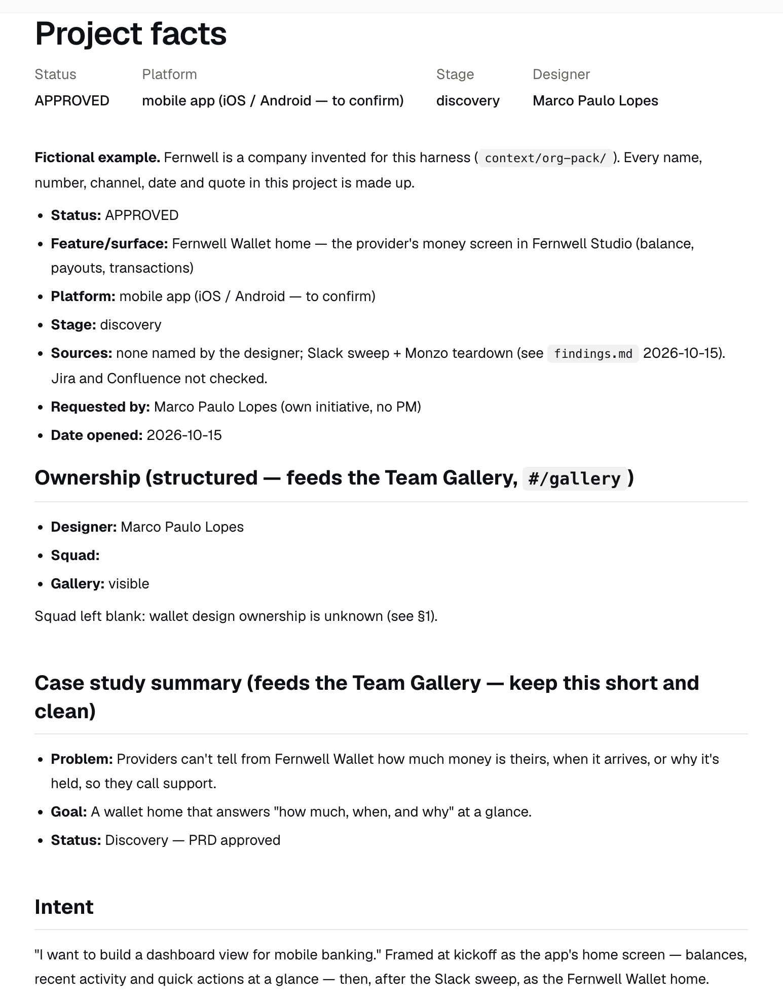

*The brief as the prototype app renders it. The kickoff answers land at the top, next to the ownership and summary fields the Team Gallery reads later.*

## 2. Research: the sweep changes the question

Next it searched the connected tools for anything already known. Slack returned about 20 relevant threads, and they changed the project. The company already had a live wallet in its provider app, and support-call summaries described the same complaints again and again: a wallet marked "blocked" with no reason, balances that changed without explanation, payouts nobody could trace.

That raised a question only I could answer, so it asked: **which dashboard is this?** The wallet home, the provider's money screen, or a generic consumer banking home as an exploration. I picked the wallet. A generic home would have ignored everything the sweep had just found.

The same panel flagged a gap. Jira and Confluence weren't connected, so the roadmap and spec searches couldn't run. It offered to wait while I connected them, or to continue on Slack alone with the gaps written into the brief. I typed my own answer, "just do base on other like monzo", and it ran a competitor teardown of Monzo's home screen through Mobbin instead. It described what Monzo does and saved no screenshots, as the harness requires for competitor material.

## 3. The PRD and the gate

From the sweep, the harness drafted a PRD in the brief. The opening answers three questions every brief has to answer: why are we doing this, what problem does it solve and for whom, and how will we know it worked. The third came back as UNKNOWN, because nobody had counted support contacts about money. The PRD says so instead of inventing a target.

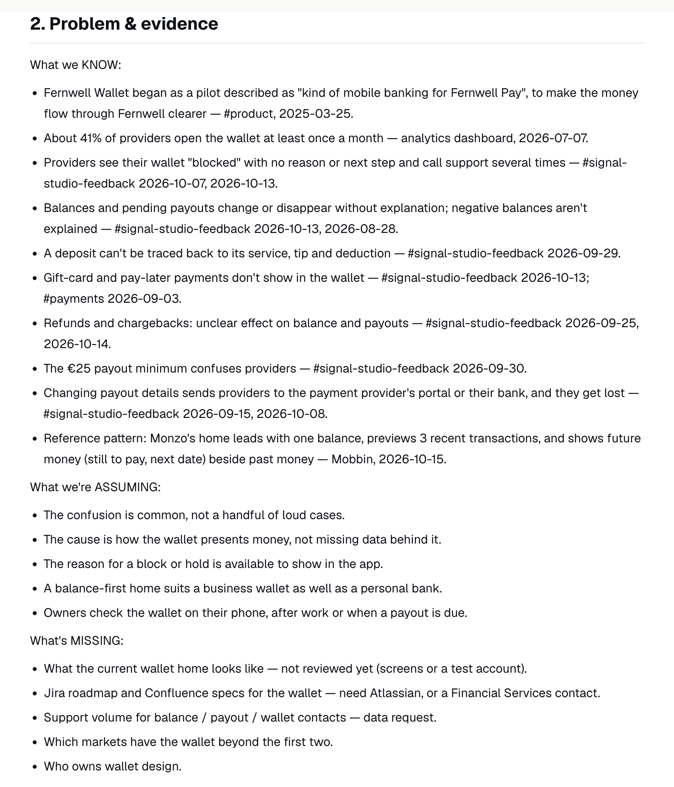

*Section 2 of the PRD keeps what's known, what's assumed and what's missing in separate lists. Every known item cites where it came from.*

It also wrote:

- an assumption map, separating what's known from what's believed
- six job stories ranked by how badly each is served today
- a method recommendation: a data request plus a review of the current screens, not interviews yet

Then came the kickoff gate: **is this PRD good enough to design against, or do we fill gaps first?** The options were approve, share screenshots of the current wallet first, check ownership with the wallet team first, or change something. I approved. The open questions stayed listed in the brief instead of disappearing.

## 4. What runs next

After approval, the harness checks three things: are the jobs clear, are the objects clear, is there a strategy? Jobs were clear. Objects and strategy weren't, so it asked what to run next: a conceptual model, a product strategy, a diagnostic, or skip to screens.

I picked the conceptual model. It defined five objects (wallet, transaction, payout, hold and payout method) and fixed the vocabulary before any screen existed. The screens say "Payout", never "deposit", because Northline already uses deposits for booking payments. They say "On hold" instead of "blocked", because "blocked" says something is wrong without saying what.

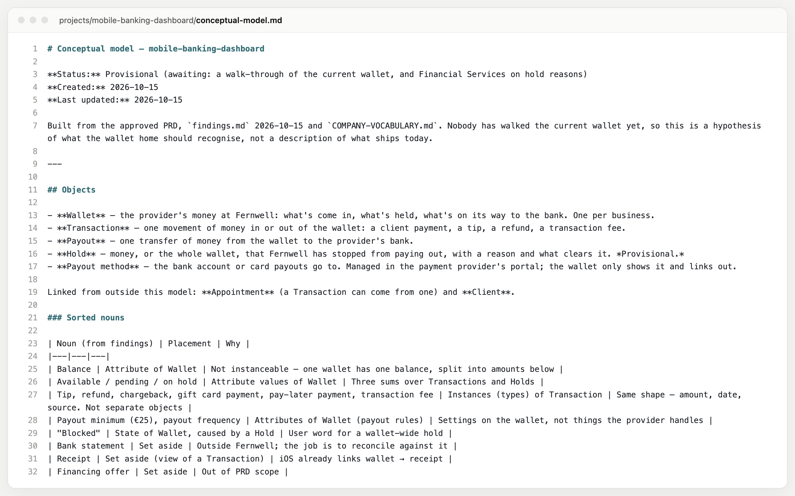

*`conceptual-model.md`: the five objects, then every noun from the research sorted into an object, an attribute, or set aside with a reason.*

Strategy was still empty, so it asked again: build screens now with the metric as an open question, do strategy first, run a diagnostic, or stop. I picked screens.

## 5. The screens: a plan, then a platform

Building screens chains several skills, so the harness showed the plan first: build the UI, check the icons, review the patterns, then audit. It asked two things: **run the plan?** and **which platform?** I said go, and both iOS and Android. The Android screen was the same body inside the iPhone frame, so it was removed on 16 October. The prototype is the iOS wallet home.

The build reuses the design system's components and tokens. Type check, lint and the design-token detector all came back clean.

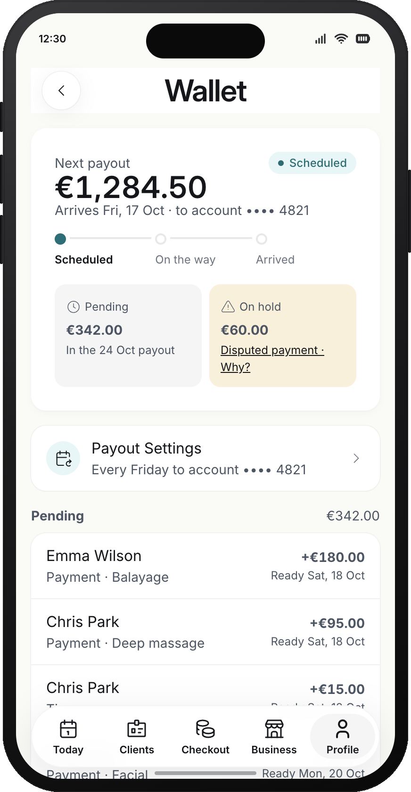

*Wallet home on iOS, shown after the review fixes in section 6.*

The pattern review found six things. It fixed one on the spot: the hold sheet had no close button, against the house rule for sheets. The other five it reported:

- **Repeated amount:** "Available" and "Next payout" showed the same €1,284.50 under two labels.
- **Missing states:** paused, failed and not-set-up weren't built.
- **Hidden settings:** payout settings were only reachable from an icon in the header.
- **Unsourced timing:** pending payments claimed a ready time with no source behind it.
- **No desktop version.**

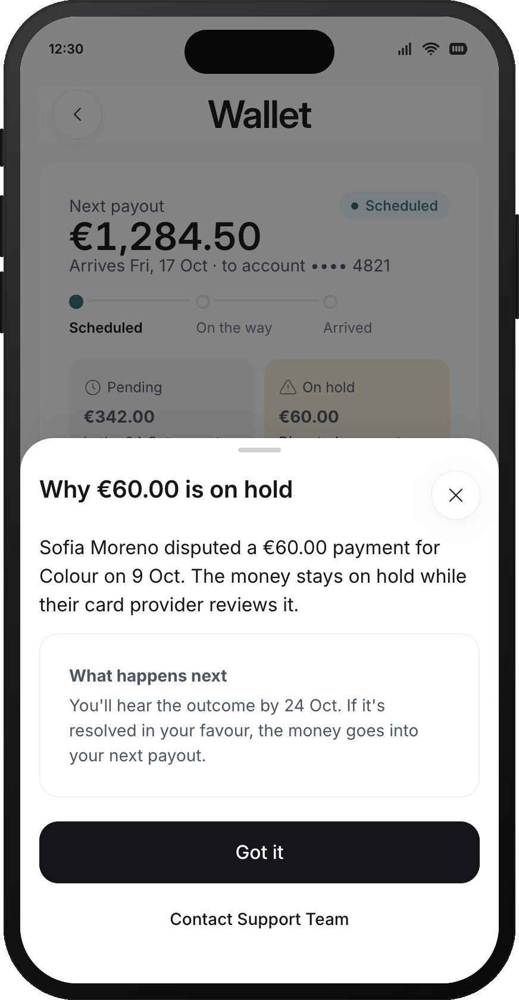

*The hold sheet with the fix in place: why the money is held, what clears it, and a close button.*

The final audit didn't run here. This harness is set to audit when work is about to be shared, not after every build, so the audit waits.

## 6. Review findings: fix now or log as debt

The harness asked what to do next (build the missing states, fix the repeated amount, add a storyboard, or stop) and, separately, **how to track the five open findings**: log them to the project's debt register, fix them now, or drop them. I chose the states and "fix now".

The next payout became the main element, so the repeated amount disappeared. Payout settings became a visible row on both platforms. Each pending payment got its own ready date. Three states were built (payouts paused, payout returned by the bank, not set up yet), each with a reason and a next step. The `content` skill wrote their copy against the company's style rules. The desktop version stayed open as a note.

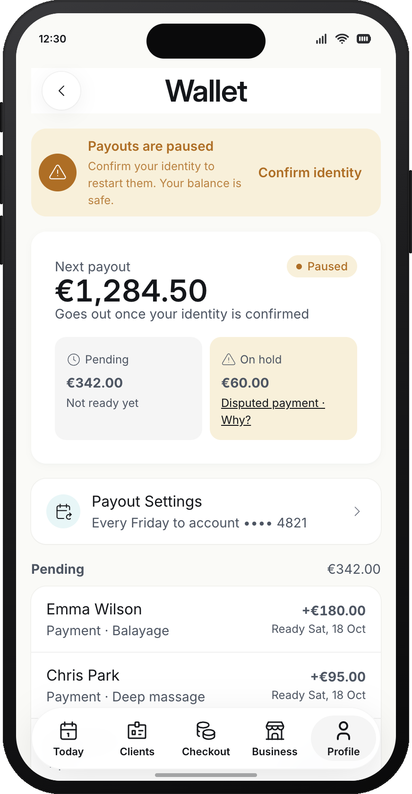
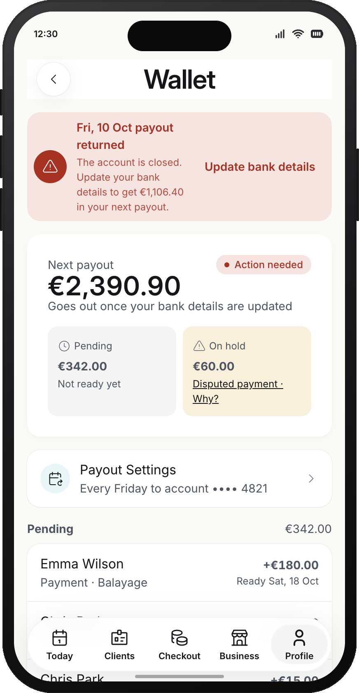
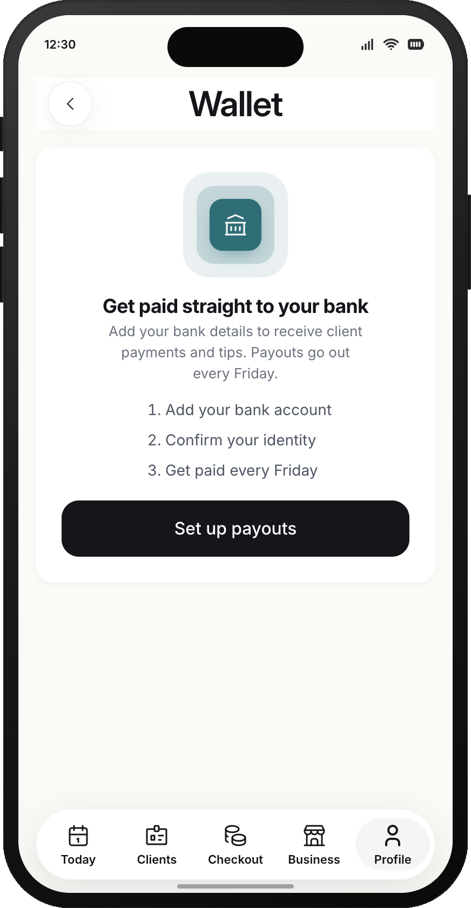

*The three states: payouts paused, a payout the bank sent back, and a wallet that isn't set up yet. Each one says what happened and what to do next.*

## 7. Storyboard

Next it offered a storyboard: a guided walkthrough that sale items one part of the screen at a time and says why it's there. I said yes. It wrote seven steps, from the next-payout amount to the hold sheet, and checked every highlight in the browser. Steps that rest on assumptions, like the payout timing, are marked as assumptions.

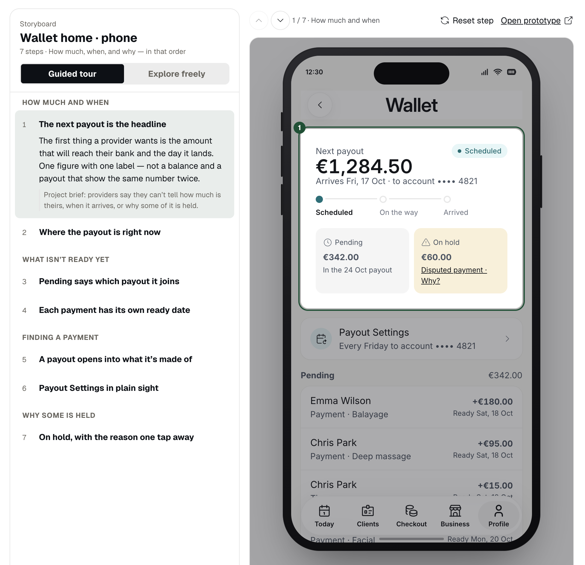

*The storyboard. One step at a time, a part of the screen is highlighted with a note on why it's there.*

## 8. The case study

Then I picked "start the case study". The `case-study` skill writes the project's story once, in eight fixed chapters: opening, problem, evidence, options considered, decision, live prototype, outcome and sources. Slides and articles render that file instead of retelling the story their own way.

It showed the outline in chat first, one line per chapter with its source file, and asked for a go. It also asked **where it should live**. By default the harness keeps real company work in `projects.local/`, which git ignores and never pushes. I wanted this project public as an example, so it moved to `projects/` as a single copy, and every name, channel and figure was replaced with the fictional Northline.

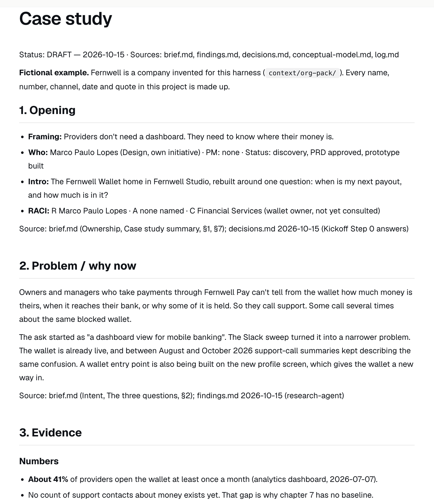

*The case study page. Each chapter ends with a `Source:` line pointing back to the file it came from.*

After saving, it asked **slides or an article?** I picked the article. The writing skill then asked who reads it, how long it should be, and which title, from three options with an outline. After the draft it asked whether it sounded like me. Every chapter of the case study ends with a source line, and the one chapter it couldn't fill is listed as skipped.

Later I asked how to show the wallet to different people, and the `presenter` skill set up four views on the same screens: Variants to switch states, Compare to put options side by side, Stage for a research session, and Ideas to browse everything we considered. The case study now embeds the rejected balance-first layout live in the options chapter, and its live-prototype chapter links to each view. The storyboard can also start from a paused or returned payout.

## 9. What people see, and what stays as notes

By now the project folder holds about twenty files. They don't all end up in the same place. There are three groups.

**What the Team Gallery shows.** Only a few lines from the brief: the project title, the designer, the problem, the goal and the status. The gallery also counts the screens and links to the prototype. Nothing else in the folder reaches it.

**What the prototype app shows.** Anyone who opens the project page can see:

- the "About this prototype" page (`about.md`)
- the brief, shown as "Project facts" (`brief.md`)
- the screens, the error states and the storyboard (`screens/`)
- pages written for people, like this one (`docs/`)
- the case study (`case-study.md`), plus the article and slides made from it (`artifacts/`)

**What stays as notes.** Everything else is for the agent and for you: research findings, decisions, the log, sources, the conceptual model, the strategy, the flow sketch and the list of open issues. The agent rereads them at every step, which is why it doesn't lose track of what was decided an hour earlier. They never show in the gallery or the prototype app, because they hold candid reasoning, rejected ideas and notes about people. They are still in the repo, though, so anyone browsing the code can read them.

So to improve a gallery card, edit the brief, not the notes. To show people something from the notes, write a page in `docs/` that quotes it or includes a screenshot, the way this article does.

### When a project appears in the Team Gallery

The Team Gallery doesn't list a project when you approve it. It reads each project's brief automatically, and shows the project only when four things are true:

1. The brief is in `projects/`, not `projects.local/`.
2. The brief names a designer.
3. The case-study summary in the brief has a problem, a goal and a status.
4. That designer has a card in the gallery's designer list.

When all four are true, it appears in the gallery straight away on your machine. Your team sees it after you commit and push. This project meets the first three. It's missing the fourth: I don't have a designer card yet, so it isn't in the gallery.

## 10. What gets logged

Every request gets one line in the harness's routing log, saying which route it matched, or that it matched none. The project keeps its own log with the same lines. Findings are append-only and dated. Decisions record what was chosen, why, and who chose it, including each answer above. That's what made the case study possible: every chapter cites a file instead of my memory.

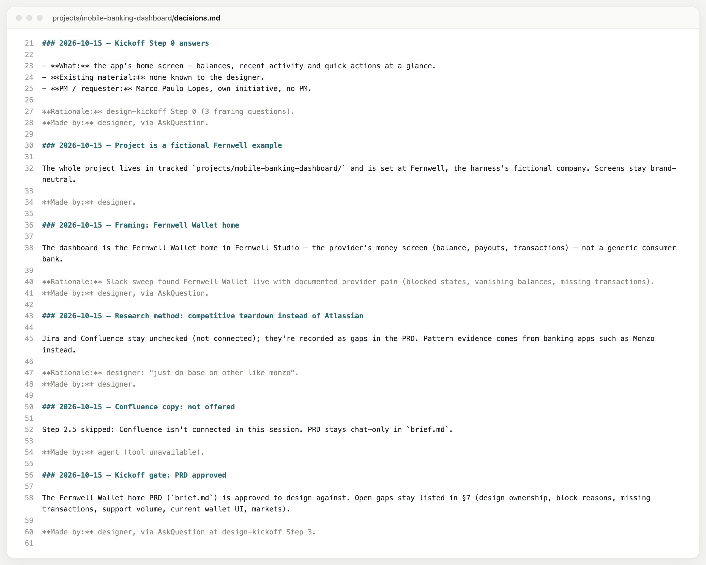

*`decisions.md`: each answer from the panels above, with the reason and who made the call.*

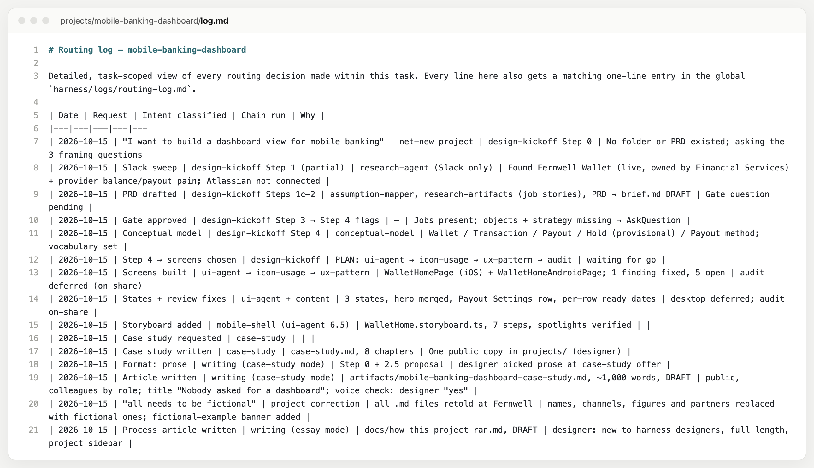

*The project's `log.md`: one row per request, from the first sentence to this article.*

## 11. Why start here, and not with a prototype

A prototype sandbox begins once you've decided to build. The harness begins earlier, and building is one possible outcome. This project shows it: the first screen came after a kickoff, a research sweep that changed the question, an approved PRD and a conceptual model.

That comes from a few parts of the harness:

- **Kickoff is the front door.** You name the problem, users, sources and open questions, and a brief is approved before a screen exists.
- **A fidelity check comes before building.** "Should I sketch this or build it?" can end with "talk it through" or "sketch it".
- **Assumptions and the decision come before the method.** You separate what you know from what you believe, and name the decision before you choose how to research it.
- **Wayfinding** maps the decisions, with no screens and no PRD until the way is clear.
- **Diagnostic** finds the weakest layer, which is often the problem or the model rather than the screen.

A sandbox is a good place to build a prototype. The harness helps you decide whether a prototype should exist, and makes it a useful one if it does. In one line: start without building a useless prototype.

## What's still open

The project isn't finished, and the files say so:

- Nobody knows how many support contacts are about money, so the success metric has no baseline.
- The hold and pause reasons are placeholders until the payment provider confirms what it sends.
- The wallet team hasn't seen the work.
- The audit hasn't run, and the gallery card is missing.

None of these is hidden. Each one is written down in the brief, the findings or this page.

---
**Sources used:** `projects/mobile-banking-dashboard/` — `brief.md`, `findings.md`, `decisions.md`, `conceptual-model.md`, `log.md`, `case-study.md`; the questions and answers come from the project session on 2026-10-15; gallery and prototype-app rules from `src/design-harness/projectFacts.ts`, `projectsIndex.ts` and `galleryData.ts`. Screenshots taken from the local prototype app on 2026-10-15 (`artifacts/snapshots/how-it-ran/`); no competitor imagery.
**Anti-slop pass:** run against `references/slop-patterns.md` and `harness/references/anti-ai-writing.md`.
**Still needs:** your edit pass. Section 2 quotes your typed answer as written; keep it or tidy it. "By the end of the afternoon" is based on the session times, 12:27 to about 16:00.
