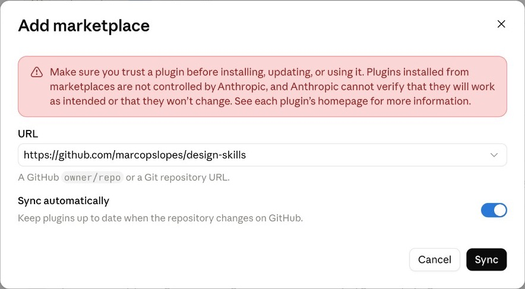

<p align="center">
  
</p>

# Design Skills

{{COUNT}} design workflows for the AI agent you already use. Free and open source.
Research a problem, shape the experience, build on your design system, and check
the work before you share it.

A skill is a written playbook your agent follows for one kind of design work: what
to bring, which steps to take, what to check, and what to hand back. You get the
same careful process every time instead of a fresh prompt.

**[Browse the skills](https://thedesignharness.com/skills.html) · [Get started](#get-started) · [The full Design Harness](https://github.com/marcopslopes/thedesignharness)**

## What you can do

- **Frame the problem.** Separate what the team knows from what it assumes, define the product's objects before drawing screens, and turn a vague request into a decision brief.
- **Run research.** Write screeners and test guides, synthesize interviews into evidence-backed patterns, and write insights that pass a so-what check.
- **Shape the experience.** Spec interaction states, motion, responsive behaviour, and product copy, with accessibility built in.
- **Build on your design system.** Compose screens from your real tokens and components, and keep Figma and code in sync.
- **Review before you share.** Critique flows, check accessibility, and review live pages and Figma files.
- **Explain and hand off.** Document the rationale, write handoff specs, and turn findings into reports and decks.

Install all {{COUNT}} skills as one plugin, one workflow at a time, or a single skill.

## Get started

**In Claude (claude.ai or the desktop app).** Go to Customize → Plugins → Add →
**Add marketplace**, paste `https://github.com/marcopslopes/design-skills`, and click
**Sync**. Open **Design skills**, wait for the security scan to finish, then click
**Add**. Code execution must be on in Settings → Capabilities.



**In Claude Code:**

```text
/plugin marketplace add marcopslopes/design-skills
/plugin install design-skills@design-skills
```

**In Codex:** run `codex plugin marketplace add marcopslopes/design-skills`, then
install from `/plugins`.

**In Cursor or any other agent:**

```bash
npx skills add marcopslopes/design-skills
```

**In ChatGPT** (Business, Enterprise, and Edu), a workspace admin imports the same
GitHub URL under Admin console → Plugins → **Import marketplace**.

**Just one skill?** Every skill below has a ZIP you can upload under Skills in
Claude or ChatGPT, or add with `npx skills add marcopslopes/design-skills --skill <name>`.

Then ask for the work in plain words. Your agent picks the matching skill:

> Map the assumptions behind our new referral feature. Separate what we know from what we believe.

> Review this checkout flow against common UX patterns and flag anything that will confuse first-time users.

Most skills work best with your product context nearby: a brief, research notes,
your design tokens, or the screens you're reviewing.

## The skills

{{CATALOG}}

## Use them on their own or with the Harness

These skills come from the [Design Harness](https://github.com/marcopslopes/thedesignharness),
a complete design workspace with routing between skills, company context, and a
prototype app. Each skill also works on its own: a short
`references/standalone-mode.md` tells the agent what to use when the Harness files
aren't there, usually your own design system, a folder you pick, or a few questions.

## Feedback and contributing

Design Skills is an early release. Feedback about what worked, what broke, and which
workflow you wish existed helps improve it.

- [Report an issue](https://github.com/marcopslopes/design-skills/issues) — a skill breaks, gives a weak result, or a workflow is missing.
- [Contributing](CONTRIBUTING.md) — skills are generated from the Harness, so improvements go there as a pull request.
- [The Design Harness site](https://thedesignharness.com) — guides and the full skill library.

Version {{VERSION}}.

## License

[MIT](LICENSE).
